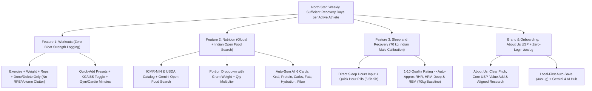

# PulseLoop MVP V1 — Product Specification & Cumulative Context Ledger

> **Author Role:** `product-manager` (Staff Product Manager AI Employee, [`.agents/skills/product-manager/SKILL.md`](file:///Users/sabbisurendra/Downloads/Fitness/.agents/skills/product-manager/SKILL.md))  
> **Cross-Employee Consultation:** Aligned with `ceo` (scope & North Star), `designer` (zero-bloat inline UI & `light-dark()` craft), `architect` (pure helpers & backward-compatible data contracts), `ai-engineer` (Gemini 4 structured food lookup), `full-stack-builder` (React 19 state & auto-sum), and `market-analyst` (ICMR-NIN / USDA & About Us USP alignment)  
> **Product:** **PulseLoop** — Workouts, Nutrition & Sleep Sufficiency Hub (`/Users/sabbisurendra/Downloads/Fitness`)  
> **Release Scope:** MVP V1 (Refined per Product Owner Review — 3 Categorized Core Features + About Us)  
> **North Star Metric:** **Weekly Sufficient Recovery Days per Active Athlete**  
> **Framework Stack:** Linear Method · Basecamp Shape Up · Teresa Torres OST · Jobs-to-be-Done (JTBD) · Deterministic PASS/FAIL QA Gates

---

## Executive Thesis

Most fitness apps operate as disconnected silos: workout loggers (Hevy, Strong) bury users in RPE/volume math while ignoring food and sleep; calorie apps (MacroFactor, MyFitnessPal) overlook Indian home-cooked portions or ignore training strain; and wearables (WHOOP, Oura Ring) lock recovery insights behind \$239–\$399/year proprietary hardware subscriptions.

**PulseLoop MVP V1** unifies **3 clearly separated core features**—**1. Workouts**, **2. Nutrition**, and **3. Sleep & Recovery**—alongside a crisp **About Us** showcase inside a single, hardware-free, URL-native workspace (`/` and `/u/[slug]`). Lifters log clean Exercise × Weight × Reps, search standardized Global (USDA) and Indian (ICMR-NIN) foods with gram-weighted portions that auto-sum across all 6 nutritional pillars (Calories, Protein, Carbs, Fats, Hydration, Fiber), and log direct Sleep Hours + 1–10 Quality with automatic **70 kg Indian adult male physiological approximation** (Resting HR, HRV, Deep & REM sleep).

---

## 1. Prompt Ledger & Cumulative Context History (All Prompts & Context Given Till Now)

Per the Product Manager directive, this section preserves **every user prompt verbatim** and the **complete cumulative technical, product, and organizational context** established across the entire build lifecycle.

### 1.1 Verbatim User Prompts in This Conversation

| # | Timestamp | Role / Target | Verbatim User Prompt |
| :--- | :--- | :--- | :--- |
| **1** | `2026-11-17T07:42:13+05:30` | System / AI Organization Setup | *"For this project, I want to create a work setup in such a way that I will create custom AI agents/AI employees where each project will have different employees. Then they will be assigned specific roles like designer, full stack builder, AI engineer, architect, product manager, finance planner, market analyst, CEO, etc. So that the instructions can be given individually to the specific AI agents/AI employees and they will be able to work on the relevant tasks. And they should also have the expertise in the domain which they were assigned to, like design, tech, and etc. And they should be able to have good access to the related files of that particular skill and should also have some certain best practices as per the latest top 1% industry trends in their specific domains. So do all this market research and keep the title of this as Market Research AI Employees."* |
| **2** | `2026-11-17T08:21:32+05:30` | `@product-manager` | *"As Product Manager, write a MVP V1 document and add it as part of artifacts, and keep all the prompts and context given till now to write the MVP."* |
| **3** | `2026-11-17T08:39:47+05:30` | `@product-manager` + Consulting Team (`ceo`, `designer`, `architect`, `full-stack-builder`, `ai-engineer`, `market-analyst`) | *"As Product Manager, I want you to take this feedback and improve the website based on the current suggestions and features. Clearly think and categorize three different core features: Workouts as a separate feature, Nutrition, and Sleep and Recovery. These three should be treated as separate features, so I will give feedback on each feature. In the Workouts feature, remove the RPE. There is no need to show this kind of information inside. The user input should simply be the name of the exercise, weight, and then the reps. Weight and reps are looking good in this way only. The name of the exercise is also looking good, and edit options are looking good, but remove things like RPE volume. The delete buttons and the set buttons are good only. This is the feedback regarding this first feature, Workouts. And the feedback about the other feature, Nutrition: Allow a free open search where the user is able to search for any food. Based on the current standards of global and Indian standards as per most reported and trusted data sources, fetch those macros and the calories. Whenever any person is entering a particular item, for example, grilled chicken breast or salmon fillet, there should be an option to select the portion size and, if possible, with an indicator of weight. The search result should have the basic customizations. Think of MyFitnessPal or Livestrong or any other nutrition tracking apps for reference. The idea is that when you search something, the most accurately possible data about that particular food item should come, and you should be able to easily add by selecting the food name and possibly quantity. These foods should automatically get added and calculated as overall calories, protein, carbs, fats, hydration, fiber, all these combined together. Now I will give feedback about the other feature, which is Sleep. First, there is no feature to add the sleep directly, the number of hours, etc. There should be an option to add the sleep hours or start and stop timings. Start and stop timing we can keep it in the second version maybe, but at least the total number of sleep, like 7 hours, 8 hours, that should be able to enter. And if they are able to rate their sleep quality, they can rate it 1 out of 10. Assume some standard data is going to like resting HR, HRV for a normal Indian 70 kg man, and then approximate those values. These are all the feedbacks for the Product Manager. Consult any relevant AI agents like Designer, CEO, etc., to achieve any specific objectives of this particular project. Also, the Market Benchmarks section need not be present. Market it as 'About Us', and this page should clearly tell what is the pitch or what is the core USB or the value addition of this particular product or website. In Market Benchmarks, keep the Industry Market Research and Clinical Best Practices applied. Keep that section intact, but try to improve the content there with content which can match the overall theme and the USB of what we are catering to."* |

### 1.2 Cumulative Project & Codebase Evolution Context (Build Ledger)

1. **Phase 1 — Core PulseLoop Sufficiency Web Application (`commit f87fc4c`, `2026-11-17 07:15`):**
   - Next.js 15 App Router (`^15.3.0`), React 19 (`^19.0.0`), TypeScript Strict Mode (`^5.8.0`), Tailwind CSS v4 (`^4.1.0`), Lucide React (`^1.16.0`).
   - Implemented deterministic closed-loop sufficiency math (`calculateSufficiencyAnalysis`) in [`src/lib/types.ts`](file:///Users/sabbisurendra/Downloads/Fitness/src/lib/types.ts), isolated `/u/[slug]` routes (`src/app/u/[slug]/page.tsx`), 3-tier persistence (`localStorage` `0ms` + `/tmp` + `@vercel/blob` `380ms` debounced via [`src/app/api/state/route.ts`](file:///Users/sabbisurendra/Downloads/Fitness/src/app/api/state/route.ts)), and CSS `light-dark()` theme parity in [`src/app/globals.css`](file:///Users/sabbisurendra/Downloads/Fitness/src/app/globals.css) + [`src/app/layout.tsx`](file:///Users/sabbisurendra/Downloads/Fitness/src/app/layout.tsx).
2. **Phase 2 — Mandatory QA Gates (`commit 98d7cd4`, `2026-11-17 07:22`):**
   - Established [`.agents/rules/qa-gates.md`](file:///Users/sabbisurendra/Downloads/Fitness/.agents/rules/qa-gates.md), [`ux-tester`](file:///Users/sabbisurendra/Downloads/Fitness/.agents/skills/ux-tester/SKILL.md), and [`tech-tester`](file:///Users/sabbisurendra/Downloads/Fitness/.agents/skills/tech-tester/SKILL.md).
3. **Phase 3 — Automated Technical Invariant Verification (`commit db3c7e3`, `2026-11-17 07:36`):**
   - Added [`scripts/verify-tech.mjs`](file:///Users/sabbisurendra/Downloads/Fitness/scripts/verify-tech.mjs) enforcing `TECH-SEC-01`, `TECH-LOGIC-01..04`, and `TECH-STORE-01`.
4. **Phase 4 — Gemini 4 Interactions API Hub (`src/app/api/gemini/route.ts`, `AGENTS.md`, `FitnessDashboard.tsx`):**
   - Official `@google/genai` (`^3.4.0`) `client.interactions.create` across `gemini-4-hydrogen`, `gemini-4-argon`, `gemini-4-carbon` (`optimize-day`, `smart-log`, stateful `coach` via `previous_interaction_id`, plus zero-downtime offline fallbacks).
5. **Phase 5 — Project-Scoped AI Employees Work Setup (`Market_Research_AI_Employees.md` & `.agents/`):**
   - Created 8 domain AI employee skills + isolated subagents (`ceo`, `product-manager`, `market-analyst`, `finance-planner`, `architect`, `full-stack-builder`, `ai-engineer`, `designer`) governed by [`.agents/rules/ai-employees-org.md`](file:///Users/sabbisurendra/Downloads/Fitness/.agents/rules/ai-employees-org.md).
6. **Phase 6 — Product Owner V1 Feedback Refinement (`2026-11-17 08:40+`):**
   - Categorized the dashboard cleanly into **1. Workouts** (RPE & Volume UI removed; Exercise + Weight + Reps + Set/Delete preserved), **2. Nutrition** (Open Global USDA + Indian ICMR-NIN food catalog [`src/lib/nutritionDatabase.ts`](file:///Users/sabbisurendra/Downloads/Fitness/src/lib/nutritionDatabase.ts) + Gemini 4 `food-search` lookup + portion/gram customizer + 6-macro auto-sum across Calories, Protein, Carbs, Fats, Hydration, Fiber), **3. Sleep & Recovery** (Direct Sleep Hours + 1–10 Quality Rating + `approximateSleepBiometricsForIndianMale70kg` auto-computing RHR, HRV, Deep & REM sleep for a 70 kg Indian man, with Start/Stop sleep timer deferred to V2), and **About Us** (Pitch, Core USP, Value Addition + aligned *Industry Market Research & Clinical Best Practices Applied*).

---

## 2. Strategic Discovery: Opportunity Solution Tree & Jobs-to-be-Done

### 2.1 Opportunity Solution Tree (Teresa Torres OST)

### 2.2 Core Jobs-to-be-Done (JTBD) Matrix

| JTBD ID | Categorized Feature | Job Statement ("When I... I want to... So I can...") | MVP V1 Solution Surface |
| :--- | :--- | :--- | :--- |
| **JTBD-01** | **1. Workouts** | *When I finish a gym set, I want to enter just the exercise name, weight, and reps without RPE or volume clutter, so I stay focused on lifting.* | Clean 4-column table (`Set`, `Weight`, `Reps`, `Done`) + `+ Set` / `Trash` buttons + 8 Quick-Add pills + 3-card session strip |
| **JTBD-02** | **2. Nutrition** | *When I eat any global or Indian food (like Grilled Chicken Breast, Salmon Fillet, Chapati, Dal, or Paneer), I want an open search that fetches trusted macros, lets me pick portion size & gram weight, and auto-calculates all 6 totals combined.* | [`src/lib/nutritionDatabase.ts`](file:///Users/sabbisurendra/Downloads/Fitness/src/lib/nutritionDatabase.ts) (ICMR-NIN + USDA) + `/api/gemini` `food-search` + portion dropdown + gram/qty calculator + 6-card `useMealSum` rollup |
| **JTBD-03** | **3. Sleep & Recovery** | *When I wake up without a fitness ring, I want to enter my total sleep hours and rate quality 1–10, and have my Resting HR, HRV, Deep, and REM approximated for a standard 70 kg Indian man so my readiness verdict still works.* | Direct Sleep Hours input + quick pills + 1–10 quality buttons + `approximateSleepBiometricsForIndianMale70kg` + V2 start/stop timer roadmap note |
| **JTBD-04** | **About Us** | *When I explore why PulseLoop exists, I want to read a clear Pitch, Core USP, Value Addition, and industry-backed clinical best practices matching that exact USP.* | `About Us` tab (`#heading-research`) presenting The Pitch, Core USP, Value Addition, and the retained & USP-aligned *Industry Market Research & Clinical Best Practices Applied* |
| **JTBD-05** | **AI Org & Persistence** | *As the project owner, I want role-specialized AI employees (`ceo`, `product-manager`, `designer`, etc.) and instant `/u/[slug]` persistence.* | `.agents/` AI employee setup + `0ms` `localStorage` + `380ms` debounced `POST /api/state` |

---

## 3. Shape Up Product Specification (MVP V1)

### 3.1 Appetite & Architectural Guardrails
- **Appetite:** Complete V1 production-buildable web app running on Next.js 15 + React 19, zero external database dependencies, zero login friction, and offline-resilient AI/food lookups.
- **Navigation Tabs (`FitnessDashboard.tsx`):** `All Modules` · `1. Workouts` · `2. Nutrition` · `3. Sleep & Recovery` · `About Us`.

### 3.2 Detailed Specifications for Each Core Feature

#### Feature 1: `1. Workouts` (Zero-Bloat Strength & Conditioning Logger)
- **Header & Controls:** Section heading `1. Workouts`, completed sets & reps counter (no total volume figure shown), `Unit: KG` / `Unit: LBS` toggle, and `+ Add Exercise` button.
- **Session Strip (3 Clean Cards):** `Workout Split / Focus`, `Time Spent in Gym (min)`, and `Cardio / Conditioning (min)` + cardio type. *(Session Intensity RPE card removed per V1 feedback.)*
- **Quick-Add Presets:** 8 one-tap exercise buttons (`Barbell Squat`, `Romanian Deadlift`, `Overhead Press`, `Pull-Ups / Chin-Ups`, `Dumbbell Lateral Raise`, `Cable Tricep Pushdown`, `Barbell Curl`, `Leg Press`).
- **Exercise Cards & Set Table:**
  - Editable Exercise Name, Muscle Group badge, `+ Set` button, `Delete <exercise>` button, per-exercise note, and overall auto-growing session note.
  - **Table Columns Strictly Scoped:** `Set` (`#1`, `#2`...), `Weight ({unit})`, `Reps`, and `Done` (completion checkbox + `×` remove set button). **RPE and Volume columns are completely removed.**
  - Unchecked sets (`completed: false`) dim visually (`opacity-50`) and are excluded from backend sufficiency strain calculations.

#### Feature 2: `2. Nutrition` (Open Global + Indian Food Search, Portions & 6-Pillar Auto-Sum)
- **6 Live Nutrition Cards:** `Calories (kcal)`, `Protein (g)`, `Carbs (g)`, `Fats (g)`, `Hydration (L)`, and `Fiber (g)` with percentage progress bars clamped `0–100%` and editable daily targets.
- **Hybrid Auto-Sum & Manual Override (`useMealSum: true` by default):**
  - Adding, editing, or deleting any food/meal row automatically sums **all 6 metrics combined** (`calories`, `protein`, `carbs`, `fats`, `fiberGrams`, `waterLiters`).
  - Typing directly into any top card unchecks `useMealSum` (`false`) to preserve manual overrides without overwriting user intent.
- **Open Food Search & Portion Customizer (`ICMR-NIN (India)` + `USDA Global`):**
  - Wrapped in semantic `<search><form>` with category chips (`All`, `Indian Staples & Meals`, `Proteins, Poultry & Fish`, `Dairy, Eggs & Plant Protein`, `Hydration & Beverages`).
  - Instant search across **curated Indian & Global foods** in [`src/lib/nutritionDatabase.ts`](file:///Users/sabbisurendra/Downloads/Fitness/src/lib/nutritionDatabase.ts) (e.g., *Grilled Chicken Breast*, *Salmon Fillet*, *Tandoori Chicken*, *Chapati / Phulka*, *Dal Tadka*, *Paneer / Paneer Tikka*, *Soya Chunks*, *Idli*, *Masala Dosa*, *Poha*, *Rolled Oats*, *Whey Isolate*, *Dahi / Curd*, *Drinking Water*, *Tender Coconut Water*, etc.).
  - **Open AI Food Lookup (`Fetch Any Food`):** Calls `POST /api/gemini` (`mode: "food-search"`) using `@google/genai` `client.interactions.create` + JSON schema (with deterministic offline fallback `buildFallbackFoodSearch`) so *any* arbitrary food query returns standardized per-100g macros, fiber, water content, and portion sizes.
  - **Portion Size & Weight Customizer:**
    - Portion dropdown (`#food-portion-select`) listing human-friendly options with explicit gram/ml weights (e.g., `1 medium breast fillet (150g)`, `1 medium katori (150g)`, `1 medium phulka / chapati (35g)`, or `Custom Weight (grams / ml)`).
    - Editable `Base Weight (grams / ml)` (`#food-grams-input`), `Qty / Servings` (`#food-quantity-input`), and `Time` (`#food-time-input`).
    - Live 6-metric preview strip (`Calories`, `Protein`, `Carbs`, `Fats`, `Fiber`, `Water`) + 1-click **`Add <Food> (<totalGrams>g) to Daily Totals`** button.
- **Meals Log & Custom Health Metrics:** Each meal row shows optional weight badge (`{weightGrams}g`), inline editable `kcal`, `P(g)`, `C(g)`, `F(g)`, `Fib(g)`, `H2O(L)`, and note; followed by Custom Health Metrics (`Creatine`, `Daily Steps`, `Electrolytes`) and overall Nutrition note.

#### Feature 3: `3. Sleep & Recovery` (Direct Hours + 1–10 Quality + 70 kg Indian Male Calibration)
- **Direct Sleep Entry & Quality Logger:**
  - Prominent **`Total Sleep Duration (hrs)`** input (`#sleep-total`) plus quick-select hour pills (`5.5h`, `6h`, `6.5h`, `7h`, `7.5h`, `8h`, `8.5h`, `9h`).
  - Prominent **`Rate Sleep Quality (1 to 10)`** input (`#sleep-quality`) plus interactive `1`–`10` rating buttons.
  - Explicit **V2 Roadmap Note**: *"Start/Stop sleep timing scheduled for V2."*
- **Standard 70 kg Indian Adult Male Physiological Approximation (`approximateSleepBiometricsForIndianMale70kg`):**
  - Default profile bodyweight calibrated to `70 kg` (`createDefaultUserProfile`).
  - Updating total sleep hours or 1–10 quality automatically approximates and populates:
    - `Deep Sleep / SWS (hrs)` (~15%–21.5% scaling with quality)
    - `REM Sleep (hrs)` (~18%–23% scaling with quality)
    - `Resting HR (bpm)` (~62 bpm baseline at 7.5h & 8/10 quality, clamped `[48, 84]`)
    - `HRV (ms)` (~60 ms RMSSD baseline at 7.5h & 8/10 quality, clamped `[25, 95]`)
  - All 4 biometric fields remain inline-editable below for users who own wearables, followed by Cross-Module Sufficiency Diagnostics and Sleep Hygiene notes.

#### Feature 4: `About Us` (Pitch, Core USP, Value Addition + Aligned Clinical Research)
- Replaces `Market Benchmarks` navigation tab with **`About Us`**.
- **Top 3 Strategic Cards:**
  1. **The Pitch:** One connected recovery loop instead of 3 siloed apps.
  2. **Our Core USP:** Hardware-free closed-loop sufficiency pairing simple Weight × Reps logging, Global (USDA) + Indian (ICMR-NIN) open food search with gram-weighted portions, and 70 kg Indian male physiological sleep calibration.
  3. **Core Value Addition:** Instant `/u/[slug]` custom URLs, zero sign-up wall, automatic 6-pillar nutrition rollups, and stateful Gemini 4 coaching.
- **Intact & USP-Aligned Subsection — `Industry Market Research & Clinical Best Practices Applied`:**
  - Retained inside `About Us` with updated cards matching PulseLoop's exact V1 theme and USP (*WHOOP & Oura Ring — Strain-to-Sleep Sufficiency*, *MyFitnessPal, Livestrong & ICMR-NIN / USDA Standards*, and *Hevy & Clinical Coaching — Zero-Bloat Inline Execution*).

### 3.3 Rabbit Holes Solved & V2 Backlog
- **Rabbit Holes Solved:** Strict unique-ID CRUD (`TECH-LOGIC-04`), safe `sanitizeSlug` path isolation (`TECH-STORE-01`), `useMealSum` automatic 6-macro sync without clobbering manual top-card overrides, offline fallback for `food-search`, and zero horizontal overflow on `360px` mobile screens.
- **Deferred to V2:** Start & Stop sleep bedtime/wake automatic duration calculation (kept out of V1 primary entry per user guidance so V1 stays ultra-fast with direct hours + 1–10 quality), wearable OAuth integrations (WHOOP/Apple Health), and multi-week trend charts.

---

## 4. Deterministic PASS / FAIL Acceptance Criteria (MVP V1 Sign-Off Matrix)

| Gate ID | Category | Verification Criterion (PASS Condition) | Verifier |
| :--- | :--- | :--- | :--- |
| **TECH-BUILD-01** | Type Safety | `npx tsc --noEmit` exits `0` under `"strict": true`. | `tech-tester` |
| **TECH-BUILD-02** | Production Build | `npm run build` compiles `/`, `/u/[slug]`, `/api/state`, `/api/gemini` cleanly. | `tech-tester` |
| **TECH-LOGIC-01..05** | Sufficiency, Food & Sleep Math | `node scripts/verify-tech.mjs` passes all existing invariants plus `approximateSleepBiometricsForIndianMale70kg` (`7.5h, 8/10 -> 62 bpm, 60 ms`), `searchFoodsCatalog`, and `calculateFoodPortionNutrition`. | `tech-tester` |
| **UX-FEAT-WORKOUT** | Feature 1: Workouts | Zero `RPE` or `Volume` controls/columns rendered inside Workouts; Exercise Name, Weight, Reps, `+ Set`, `Done` checkbox, and Delete buttons work by unique ID. | `ux-tester` |
| **UX-FEAT-NUTRITION** | Feature 2: Nutrition | Open search matches Global (`Grilled Chicken Breast`, `Salmon Fillet`) & Indian (`Chapati`, `Dal`, `Paneer`) foods + `Fetch Any Food` works for arbitrary items; portion dropdown displays gram weights; adding updates all 6 cards (`Calories`, `Protein`, `Carbs`, `Fats`, `Hydration`, `Fiber`) together. | `ux-tester` |
| **UX-FEAT-SLEEP** | Feature 3: Sleep | Direct Total Sleep Hours + 1–10 Sleep Quality inputs and quick buttons work and auto-approximate Deep, REM, RHR, and HRV for a 70 kg Indian man; V2 start/stop timer note visible. | `ux-tester` |
| **UX-FEAT-ABOUT** | Feature 4: About Us | `About Us` tab replaces `Market Benchmarks`, clearly communicates Pitch, Core USP, and Value Addition, and retains the upgraded *Industry Market Research & Clinical Best Practices Applied* subsection. | `ux-tester` |
| **UX-RESP & THEME** | Responsive & A11y | Zero horizontal overflow (`scrollWidth <= innerWidth`) at `360×800`, `768×1024`, `1280×900`, Dark/Light theme persistence, zero console/network errors. | `ux-tester` |
