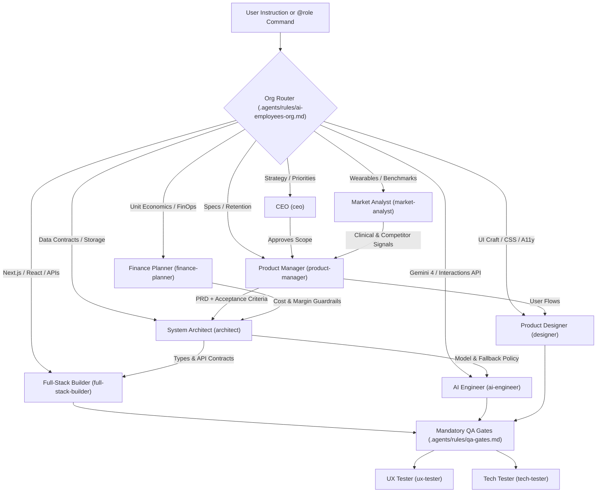

# Market Research AI Employees

> **Scope:** Project-Scoped AI Employee Architecture & Top 1% Domain Operating Manual for **PulseLoop** (`/Users/sabbisurendra/Downloads/Fitness`)  
> **Research Date:** November 2026  
> **Architecture Standard:** Antigravity `.agents/` Workspace Discovery + Progressive Disclosure Context Engineering + Role-Based Multi-Agent SOPs

---

## 1. Executive Summary & Industry Landscape (2025–2026)

### 1.1 From "One Generalist Chatbot" to Project-Scoped AI Employees
Modern AI engineering in 2025–2026 has decisively moved away from single, bloated monolithic system prompts toward **role-specialized, context-isolated AI employees**. Industry benchmarks across **MetaGPT**, **CrewAI**, **Anthropic's Agent Research**, and **Google Antigravity's Workspace Customization Architecture** converge on four foundational truths:

1. **Role Specialization Beats Monolithic Prompting:**
   - **MetaGPT** demonstrated that mapping human corporate roles (Product Manager, Architect, Engineer, QA) onto Standard Operating Procedures (SOPs) drastically reduces hallucination cascades by enforcing structured handoff artifacts (PRDs, data schemas, design contracts) rather than unstructured chat.
   - **CrewAI** proved that assigning explicit **Role, Goal, Backstory, and Scoped Tools** creates higher-precision outputs when workers focus on one domain (e.g., unit economics or visual craft) instead of juggling conflicting priorities in one turn.
2. **Context Engineering > Prompt Engineering (Combating "Context Rot"):**
   - As documented in Anthropic's *Effective Context Engineering for AI Agents*, loading every rule, file path, and domain manual upfront into every conversation causes **context rot**—degrading instruction adherence, wasting tokens, and diluting model attention.
   - The top 1% solution is **3-Layer Progressive Disclosure**:
     - **Layer 1 — Discovery (Metadata Only):** The orchestrator sees only each AI employee's short `name` and trigger `description`.
     - **Layer 2 — Activation (`SKILL.md` / Agent Persona):** When an individual AI employee is addressed (by name, `@role`, or domain task), only that employee's domain playbook and file-access boundaries load into context.
     - **Layer 3 — Execution (Just-in-Time File Access):** The employee reads only the specific project source files mapped to its role, writes scoped deliverables, and hands off concise artifacts.
3. **Anthropic's Golden Rule — Workflows vs. Autonomous Loops:**
   - Use **predefined deterministic workflows** (Prompt Chaining, Routing, Evaluator-Optimizer) wherever steps are predictable (e.g., Architecture -> Implementation -> `tech-tester` / `ux-tester`).
   - Reserve **autonomous multi-agent swarms / subagents** for parallel, non-overlapping exploration or multi-specialist synthesis.
4. **Adversarial Verification (Evaluator-Optimizer Loops):**
   - An engineer or designer AI employee must never be the sole judge of its own work. Pairing builders (`full-stack-builder`, `ai-engineer`, `designer`) with dedicated QA employees (`ux-tester`, `tech-tester`) prevents confirmation bias and enforces production invariants before completion.

---

## 2. Multi-Project Isolation Architecture (Different Employees Per Project)

To ensure **every project has its own distinct AI employees** without polluting other repositories on your machine, all employee definitions live inside the repository's own `.agents/` customization root rather than the global `~/.gemini/config/` folder:

- **Workspace-Scoped Root (`/Users/sabbisurendra/Downloads/Fitness/.agents/`):**
  - `.agents/rules/ai-employees-org.md` — Organizational directory and routing protocol for this project.
  - `.agents/rules/qa-gates.md` — Mandatory post-edit verification gate (`ux-tester` + `tech-tester`).
  - `.agents/skills/<role>/SKILL.md` — On-demand domain playbooks, Top 1% industry best practices, and exact project file-access maps.
  - `.agents/agents/<role>.md` — Dedicated subagent personas for isolated single-employee delegation.
- **How Another Project Stays Isolated:** When you open a different codebase (e.g., an e-commerce store or fintech backend), Antigravity discovers that project's own `.agents/` directory—giving that project completely different AI employees, domain rules, and file-access scopes.

### 2.1 Four Ways to Instruct Individual AI Employees in This Setup

1. **Direct Individual Addressing in Chat:**
   - Mention the employee by role or handle: e.g., *"@designer audit the mobile spacing on the Sleep module"*, *"@ai-engineer optimize the Gemini Smart Log prompt"*, or *"Ask our finance-planner to estimate Gemini 4 token costs per 1,000 active users."*
   - The organizational router activates that specific employee's `SKILL.md`, enforces its file-access map, and responds strictly through its domain lens.
2. **Isolated Subagent Delegation (`invoke_subagent`):**
   - Each role has a corresponding `.agents/agents/<role>.md` persona so tasks requiring deep investigation or isolated execution can be delegated to that specific employee without cluttering the main context window.
3. **Parallel Multi-Employee Swarm (`/teamwork`):**
   - For multi-disciplinary launches (e.g., adding a new Health Biomarker module), spawn `architect`, `designer`, `full-stack-builder`, `ai-engineer`, and `tech-tester` as named workers collaborating via the shared board without file-edit collisions.
4. **Sequential Executive SOP Pipeline:**
   - Run cross-functional decisions top-down: `ceo` (vision & go/no-go) -> `market-analyst` & `finance-planner` (competitive & unit economics validation) -> `product-manager` (Shape Up pitch & acceptance criteria) -> `architect` (data schema & security contract) -> `full-stack-builder` / `ai-engineer` / `designer` (implementation) -> `ux-tester` & `tech-tester` (verification).

---

## 3. Complete AI Employee Roster, File-Ownership Matrix & Top 1% Trends

### 3.1 Master Roster & File-Access Matrix

| Employee ID | Title | Primary Domain | Primary Owned / Target Files | Supporting Read Access |
| :--- | :--- | :--- | :--- | :--- |
| `ceo` | Chief Executive Officer | Vision, prioritization, capital/token allocation, go/no-go | `docs/MARKET_RESEARCH_AI_EMPLOYEES.md` | All repo files (read-only executive oversight) |
| `product-manager` | Staff Product Manager | JTBD, Shape Up specs, retention, acceptance criteria | `docs/MARKET_RESEARCH_AI_EMPLOYEES.md` | `src/lib/types.ts`, `src/components/FitnessDashboard.tsx`, `.agents/skills/ux-tester/SKILL.md` |
| `market-analyst` | Principal Market Analyst | Wearables/fitness benchmarks, competitive positioning | `src/components/FitnessDashboard.tsx` (Module 4: `research` tab), `docs/MARKET_RESEARCH_AI_EMPLOYEES.md` | `src/lib/types.ts` (clinical thresholds & strain formulas) |
| `finance-planner` | Strategic Finance & AI FinOps Lead | Unit economics, GenAI token margins, storage sizing | `docs/MARKET_RESEARCH_AI_EMPLOYEES.md` | `src/app/api/gemini/route.ts`, `src/app/api/state/route.ts`, `package.json` |
| `architect` | Principal System Architect | Data schemas, 3-tier storage resilience, security | `src/lib/types.ts`, `src/app/api/state/route.ts`, `next.config.mjs`, `tsconfig.json` | `src/app/api/gemini/route.ts`, `scripts/verify-tech.mjs`, `AGENTS.md` |
| `full-stack-builder` | Principal Full-Stack Builder | Next.js 15 App Router, React 19 UI state, CRUD & sync | `src/components/FitnessDashboard.tsx`, `src/app/page.tsx`, `src/app/u/[slug]/page.tsx`, `src/app/api/state/route.ts` | `src/lib/types.ts`, `src/app/layout.tsx`, `package.json` |
| `ai-engineer` | Principal AI Engineer | `@google/genai`, Gemini 4 Interactions API, schemas | `src/app/api/gemini/route.ts`, `AGENTS.md` | `src/lib/types.ts` (`AiCoachMessage`, `AiRecoveryPrescription`), `src/components/FitnessDashboard.tsx` (AI Coach / Smart Log) |
| `designer` | Staff Product Designer | Visual craft, CSS `light-dark()`, responsive layout, A11y | `src/app/globals.css`, `src/app/layout.tsx`, `src/components/FitnessDashboard.tsx` (JSX/Tailwind layout) | `.agents/skills/ux-tester/SKILL.md`, `src/lib/types.ts` |
| `ux-tester` | Principal UX QA Gatekeeper | Responsive (`360/768/1280`), theme parity, interactive flows | `.agents/skills/ux-tester/SKILL.md` | `src/components/FitnessDashboard.tsx`, `src/app/globals.css`, `src/app/layout.tsx` |
| `tech-tester` | Principal Technical QA Gatekeeper | TypeScript strictness, mathematical invariants, storage/security | `.agents/skills/tech-tester/SKILL.md`, `scripts/verify-tech.mjs` | `src/lib/types.ts`, `src/app/api/state/route.ts`, `src/app/api/gemini/route.ts`, `src/components/FitnessDashboard.tsx` |

---

### 3.2 Domain Deep Dives & Top 1% Industry Best Practices per Employee

#### 1. `ceo` — Chief Executive Officer & Executive Orchestrator
- **Core Mandate:** Protect product focus, align all employees around PulseLoop's North Star Metric (**Weekly Sufficient Recovery Days per Active Athlete**), and make decisive build/cut/ship calls.
- **Top 1% Industry Trends & Best Practices:**
  - **Founder Mode (Brian Chesky / Paul Graham):** Skip layers of unnecessary status meetings; inspect core user artifacts directly (e.g., the live Readiness banner and logging latency) and hold skip-level quality bars.
  - **Amazon Working Backwards (PR/FAQ):** Require every major new initiative to state the user problem, measurable outcome, and failure risks in a 1-page brief before `architect` or `full-stack-builder` write code.
  - **Ruthless Scope Discipline & RICE Prioritization:** Reject feature bloat that violates PulseLoop's core promise (*zero-modal inline logging in under 15 seconds*).
  - **Single-Threaded Ownership:** Assign exactly one primary owner employee per deliverable so accountability is unambiguous.

#### 2. `product-manager` — Staff Product Manager
- **Core Mandate:** Translate athlete pain points into crisp, testable specs that increase daily logging completion and closed-loop habit retention.
- **Top 1% Industry Trends & Best Practices:**
  - **The Linear Method:** Write short, high-signal issue specs instead of multi-page bloated PRDs; prioritize speed, keyboard-first workflows, and zero-friction polish.
  - **Basecamp Shape Up:** Define fixed **Appetite** (e.g., 1 sprint / small batch) and variable **Scope**; ship complete vertical slices with clear "No-Gos" and "Rabbit Holes" flagged early.
  - **Teresa Torres Continuous Discovery & Opportunity Solution Trees (OST):** Link every UI change directly to an outcome (*Daily Log Retention* or *Sufficiency Loop Clarity*), never shipping features just because a competitor has them.
  - **Jobs-to-be-Done (JTBD):** Distinguish between *Logging Mode* (post-gym speed via Smart Log or Quick-Add presets) and *Diagnostic Mode* (understanding why Readiness dropped and what meal/sleep action closes the deficit).

#### 3. `market-analyst` — Principal Market & Competitive Intelligence Analyst
- **Core Mandate:** Maintain PulseLoop's strategic edge against wearable ecosystems and nutrition/workout apps, keeping Module 4 (`Industry Market Research & Clinical Best Practices Applied`) accurate and differentiating.
- **Top 1% Industry Trends & Best Practices:**
  - **Competitive Teardown Benchmark Matrix (2025–2026):**
    - **WHOOP & Oura Ring Gen 4:** Gold standard for closed-loop *Strain -> Sleep Need* physiology, HRV/RHR readiness scoring, and Deep Sleep (SWS) tissue-repair thresholds—but locked behind expensive hardware subscriptions (\$239–\$399/yr + ring cost) and weak resistance-training volume tracking.
    - **Apple Watch Vitals & Samsung Energy Score:** Best-in-class glanceable status cards and multi-pillar anomaly detection (`Optimal`, `Borderline`, `Deficit`), yet siloed from detailed macro/protein sufficiency math.
    - **Hevy & Strong:** Best-in-class set/rep/weight/RPE inline tables and quick-add presets—yet blind to sleep debt and daily protein sufficiency.
    - **MacroFactor & Cronometer Pro:** Gold standard for energy/protein precision and custom micronutrient/supplement metrics—yet disconnected from gym strain.
  - **April Dunford's Category Positioning & Hamilton Helmer's *7 Powers*:** Position PulseLoop via **Counter-Positioning**—unifying gym volume, nutrition availability, and sleep architecture into one hardware-agnostic, zero-friction, URL-native workspace (`/u/[slug]`) without forcing users into a proprietary wearable lock-in.
  - **Evidence-Based Sports Physiology:** Ground benchmarks in peer-reviewed sports science (e.g., Deep Sleep SWS targets `1.1h–1.5h+` scaling with CNS load; protein synthesis availability `>= 85%–92%` of target on high-strain days).

#### 4. `finance-planner` — Strategic Finance Planner & AI FinOps Lead
- **Core Mandate:** Guard unit economics, GenAI inference margins, and cloud storage costs as PulseLoop scales across `/u/[slug]` workspaces.
- **Top 1% Industry Trends & Best Practices:**
  - **FinOps for GenAI (Bessemer / a16z AI Gross Margin Playbook):** Target `>= 70%` gross margins on AI-assisted tiers by avoiding blind calls to heavyweight frontier models for trivial tasks.
    - **Tiered Model Routing (Observed in `src/app/api/gemini/route.ts`):** Route high-frequency structured JSON extraction (`smart-log`) and routine `optimize-day` calls to fast, cost-efficient `gemini-4-hydrogen` by default, reserving `gemini-4-argon` and `gemini-4-carbon` for deep coaching analysis when requested.
    - **Stateful Token Savings:** Use the Gemini Interactions API `previous_interaction_id` for multi-turn `coach` threads instead of re-paying input token costs for the full historical transcript on every message.
    - **Zero-Cost Deterministic Compute & Offline Fallbacks:** Run `calculateSufficiencyAnalysis(entry, profile)` 100% locally in TypeScript (`\$0` API cost, `0ms` latency) and maintain deterministic local fallbacks (`buildFallbackPrescription`, `buildFallbackSmartLog`) when `GEMINI_API_KEY` is absent or quota-constrained.
  - **Storage & Bandwidth FinOps:** Enforce client-side debouncing (`380ms` in `FitnessDashboard.tsx`) before calling `POST /api/state` so rapid typing generates one Vercel Blob `put()` write rather than one write per keystroke.
  - **B2C/Prosumer SaaS Metrics:** Model LTV:CAC (`>= 3:1`), CAC payback (`< 6 months`), free-to-paid AI Coach conversion, and per-MAU Gemini API ceiling caps.

#### 5. `architect` — Principal Systems & Data Architect
- **Core Mandate:** Protect PulseLoop's data contracts, local-first synchronization guarantees, pure deterministic math invariants, and security boundaries.
- **Top 1% Industry Trends & Best Practices:**
  - **Local-First Software Principles (Kleppmann / Ink & Switch):** Instant `0ms` synchronous persistence to `localStorage` (`pulse-loop-profile-${slug}`) paired with asynchronous, non-blocking cloud sync (`POST /api/state`), ensuring zero data loss offline or under transient network failures.
  - **3-Tier Storage Resilience (`src/app/api/state/route.ts`):** Graceful read/write degradation (`cloud-blob` via `@vercel/blob` -> `local-fs` in `/tmp` -> deterministic `createDefaultUserProfile(slug)`) without crashing when `BLOB_READ_WRITE_TOKEN` is unset at build or runtime.
  - **Zero-Trust Slug & Input Sanitization:** Enforce `sanitizeSlug` (`[a-z0-9-_]`, max `48` chars, fallback `"main"`) across both state and Gemini routes to eliminate path traversal and injection risks.
  - **Pure Core / Imperative Shell Separation:** Keep `calculateSufficiencyAnalysis` in `src/lib/types.ts` completely pure, side-effect-free, `NaN`-safe (guarding division by zero when targets or `totalHours === 0`), and strictly bounded (`strainScore` clamped `[2.0, 20.8]`, `readinessScore` integer clamped `[12, 99]`).
  - **Strict Unique-ID Mutation Integrity:** Mandate `id`-based updates (`ex.id`, `s.id`, `m.id`, `cm.id`) across all collection reducers—never array-index fallbacks.

#### 6. `full-stack-builder` — Principal Full-Stack Builder
- **Core Mandate:** Build fast, rock-solid Next.js 15 App Router + React 19 UI flows, state handlers, and API routes that respect strict TypeScript and zero-waterfall execution.
- **Top 1% Industry Trends & Best Practices:**
  - **Next.js 15 & React 19 Correctness:** Handle async route params (`params: Promise<{ slug: string }>` in `src/app/u/[slug]/page.tsx`), avoid hydration mismatches (`suppressHydrationWarning` + pre-paint theme script in `src/app/layout.tsx`), and keep `"use client"` boundaries cleanly isolated.
  - **Vercel React Performance Discipline:** Zero serial data-fetching waterfalls; coalesce rapid keystroke saves via `saveTimerRef` (`380ms` debounce); avoid redundant full-tree re-renders or leaked timers (`clearTimeout`, cancellation flags in `useEffect`).
  - **Hybrid User-Intent Preservation:** Respect explicit manual user overrides (e.g., typing directly into daily `Calories` or `Protein` automatically disables `useMealSum: false` rather than fighting the user's input).
  - **IME & Keyboard Safety:** Guard Enter-to-submit handlers with `e.nativeEvent.isComposing || e.keyCode === 229` so CJK/IME composition never triggers premature form submissions.

#### 7. `ai-engineer` — Principal AI & Context Engineer
- **Core Mandate:** Own PulseLoop's Gemini 4 integration (`@google/genai >= 3.4.0`), stateful Interactions API orchestration, structured JSON schemas, and telemetry context compression.
- **Top 1% Industry Trends & Best Practices:**
  - **Official SDK & Current Model Discipline (`AGENTS.md`):** Exclusively use `@google/genai` (`client.interactions.create`) with Gemini 4 models (`gemini-4-hydrogen`, `gemini-4-argon`, `gemini-4-carbon`). Never regress to deprecated `@google/generative-ai` or `gemini-1.5/2.0/2.5` models, and never expose `GEMINI_API_KEY` on the client.
  - **Schema-Constrained Structured Outputs:** Use `response_format: { type: "text", mime_type: "application/json", schema: ... }` for `optimize-day` and `smart-log` so AI outputs hydrate Workout sets and Nutrition meals deterministically with zero regex scraping fragility.
  - **Compact Telemetry Context Engineering:** Serialize only dense, high-signal telemetry in `buildTelemetryContext` (workout sets/volume, macro ratios, sleep architecture, readiness verdict) instead of raw UI state blobs.
  - **Stateful Threading + Resilient Fallbacks:** Chain multi-turn `coach` conversations via `previous_interaction_id`, filtering out `offline_fallback_*` synthetic IDs, and ensure every AI surface works cleanly even offline via deterministic heuristics.

#### 8. `designer` — Staff Product Designer & Design Systems Lead
- **Core Mandate:** Craft an ultra-legible, zero-friction telemetry interface inspired by Linear, Apple Watch Vitals, and WHOOP 4.0 across dark/light themes and mobile/tablet/desktop viewports.
- **Top 1% Industry Trends & Best Practices:**
  - **Modern Adaptive Theming (`light-dark()` + Zero FOUC):** Drive `--bg-canvas`, `--bg-surface`, `--bg-elevated`, `--text-primary`, `--text-muted`, and `--border-subtle` via native CSS `light-dark()` synced with `<meta name="color-scheme">` in `src/app/globals.css` and `src/app/layout.tsx`.
  - **Color-Blind Safe Semantic Feedback:** Never rely on color alone for sufficiency verdicts (`optimal`, `moderate`, `deficit`); pair Emerald/Amber/Rose tokens with explicit icons (`CheckCircle2`, `AlertTriangle`, `AlertOctagon`) and plain-English diagnostic labels.
  - **Native Modern CSS Ergonomics:** Use `field-sizing: content` (`.auto-grow-textarea`, `min-block-size: 2.75lh`, `max-block-size: 10lh`) for inline notes, `text-wrap: balance` / `pretty` for typography, and responsive Tailwind grids (`grid-cols-2 sm:grid-cols-4`, `lg:grid-cols-6`, `lg:grid-cols-8`) with contained `.overflow-x-auto` tables so `360px` viewports never horizontally overflow.
  - **Coarse-Pointer Mobile Craft:** Enforce `font-size: max(1rem, 1em)` and `min-block-size: 40px` under `@media (pointer: coarse)` to prevent iOS Safari input auto-zoom, pair numeric fields with `inputMode="numeric"` / `inputMode="decimal"`, and require explicit `aria-label` / `<label>` + `role="status" aria-live="polite"` sync badges.

#### 9 & 10. `ux-tester` & `tech-tester` — Mandatory QA Gatekeepers
- Already established in `.agents/skills/ux-tester/SKILL.md`, `.agents/skills/tech-tester/SKILL.md`, `.agents/rules/qa-gates.md`, and `scripts/verify-tech.mjs`.
- **Role in the AI Organization:** Act as the mandatory **Evaluator** in the Evaluator-Optimizer loop. No code, UI, formula, or AI endpoint change ships without passing `npx tsc --noEmit`, `npm run build`, `node scripts/verify-tech.mjs`, and the responsive/a11y/persistence UX checklist.

---

## 4. End-to-End SOP Workflow & Practical Usage Playbook

### 4.1 Standard Cross-Employee Execution Pipeline
1. **Align (`ceo` + `product-manager`):** Clarify the user's outcome, define fixed appetite and acceptance criteria, and confirm alignment with PulseLoop's zero-friction sufficiency loop.
2. **Validate (`market-analyst` + `finance-planner`):** Benchmark against WHOOP/Oura/Hevy/MacroFactor expectations and verify token/storage cost discipline.
3. **Design & Architect (`architect` + `designer`):** Lock `src/lib/types.ts` contracts, security sanitization, `light-dark()` design tokens, and mobile ergonomics before implementation.
4. **Build (`full-stack-builder` + `ai-engineer`):** Implement UI, state reducers, API routes, and Gemini 4 Interactions API workflows within each role's owned files.
5. **Verify (`ux-tester` + `tech-tester`):** Run static typechecking, production build, mathematical invariants, and responsive/theme/console verification before reporting completion.

### 4.2 Quick-Start Prompts for Addressing Individual AI Employees
- **Address CEO:** *"As `ceo`, review our current feature backlog and decide the top 2 highest-leverage Q4 initiatives for PulseLoop."*
- **Address Product Manager:** *"As `product-manager`, write a Shape Up pitch for a weekly recovery trend view without cluttering the daily inline workflow."*
- **Address Market Analyst:** *"As `market-analyst`, compare our Sleep & Strain sufficiency thresholds against Oura Gen 4 and WHOOP and update Module 4."*
- **Address Finance Planner:** *"As `finance-planner`, audit `src/app/api/gemini/route.ts` token usage and model routing for 10,000 DAU cost efficiency."*
- **Address Architect:** *"As `architect`, design the data schema migration in `src/lib/types.ts` for multi-week readiness streaks with backward compatibility."*
- **Address Full-Stack Builder:** *"As `full-stack-builder`, implement CSV/JSON export in `FitnessDashboard.tsx` preserving unique-ID lookup safety."*
- **Address AI Engineer:** *"As `ai-engineer`, refine the `smart-log` structured output schema in `src/app/api/gemini/route.ts` to support RPE and hydration."*
- **Address Designer:** *"As `designer`, audit light-mode contrast and 360px wrapping across all cards in `FitnessDashboard.tsx` and `globals.css`."*
