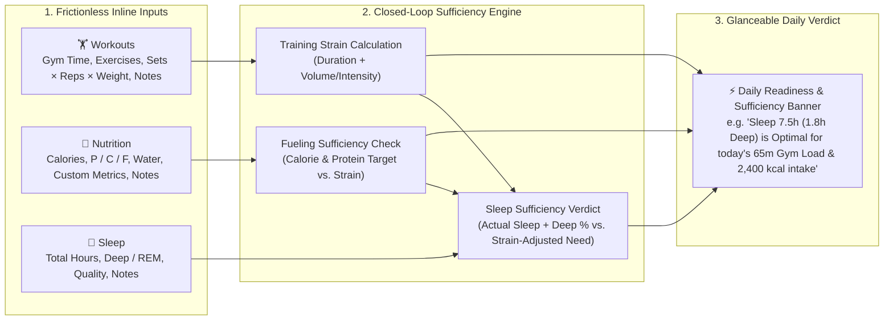

# Fitness, Nutrition & Sleep Web App — Market Research & Implementation Plan

---

## 1. Deep-Dive Market Research: Wearables, Apps & Clinical Systems

The modern fitness and health technology market has shifted away from isolated metric counting (raw steps or standalone calorie logs) toward **closed-loop recovery intelligence** and **zero-friction inline logging**. Below is a comprehensive synthesis of industry leaders, smartwatches, specialist tracking apps, and professional clinical platforms.

### A. Industry Benchmarks & Ecosystem Comparison

| Category | Brand / Platform | Core Pillars & Signature Metrics | UI/UX Strengths (Best Practices) | Practical Adoption Pitfalls |
| :--- | :--- | :--- | :--- | :--- |
| **Recovery & Strain Wearables** | **WHOOP** | **Strain (0–21 scale)**, **Recovery (0–100%)**, **Sleep Need vs. Actual** | Closed-loop narrative: yesterday's gym strain directly increases tonight's required sleep duration. High-contrast, glanceable readiness rings. | Hardware lock-in; no native workout set/rep weight logging or macro tracking without external integrations. |
| **Longevity & Sleep Wearables** | **Oura Ring** | **Readiness Score**, **Sleep Architecture (Deep, REM, Light)**, **Restorative Time** | Calm, minimalist editorial design. Leads with a 1-line human insight before showing numbers. Zero visual clutter. | Passive-only; users cannot log gym exercises, sets, reps, or detailed nutrition milestones inline. |
| **Smartwatch Ecosystems** | **Apple Watch (Health / Vitals)**, **Samsung Galaxy Watch (Energy Score)**, **Google / Fitbit (Daily Readiness)** | **Activity Rings**, **Training Load**, **Vitals / Overnight Baseline**, **Energy Score** | Mobile-first thumb-zone ergonomics, color-coded status pills (`Optimal`, `Pay Attention`), widget-style cards that work on any screen size. | Data sits in separate sub-apps; weak correlation between daily macro intake (e.g., low protein/carbs) and sleep recovery. |
| **Performance Smartwatches** | **Garmin** | **Body Battery (0–100)**, **Training Readiness**, **Acute vs. Chronic Load** | Deep telemetry for serious athletes; tracks cumulative fatigue against recovery hours. | Cluttered, complex menus; high cognitive load for everyday logging. |
| **Strength & Gym Loggers** | **Hevy / Strong** | **Gym Duration**, **Exercises**, **Sets × Reps × Weight**, **RPE / Volume** | **Spreadsheet-style inline rows**: tap a number, type with numeric keypad, auto-advance. Pre-fills previous session values. | Completely ignores nutrition and sleep; doesn't warn you if you are under-slept or under-fueled for heavy lifting. |
| **Nutrition & Macro Trackers** | **MacroFactor / Cronometer** | **Calories**, **Macros (P/C/F)**, **Fiber, Hydration, Micros**, **Dynamic TDEE** | Instant macro progress bars, timeline-based quick entry, forgiving adherence-neutral colors. | Barcode/database search fatigue causes ~70% of users to quit when they just want to type quick numbers or notes. |
| **Pro Gym & Nutrition Clinics** | **TrueCoach + Cronometer Pro / Dexa Clinics** | **Energy Availability (EA)**, **Protein g/kg**, **Sleep Architecture vs. Glycogen Depletion** | Coach-client shared URL dashboard; heavy emphasis on **free-text qualitative notes** alongside biometric numbers (e.g., *"Felt flat on squats, ate late"*). | Requires juggling multiple expensive B2B portals instead of one unified, instant link. |

---

### B. Universally Accepted Best Practices vs. Practical Use Cases

1. **The "Closed-Loop" Sufficiency Formula (Inspired by WHOOP + Clinical Sports Science):**
   - **Why it matters:** Sleeping 7 hours is sufficient on a rest day, but **insufficient** after a 75-minute heavy leg session or during a steep caloric deficit.
   - **How our app solves it:** We compute a live **Sufficiency & Readiness Verdict** at the top of the screen combining all three modules:
     - **Base Sleep Need** (e.g., `7.5 hrs`) + **Workout Strain Adjustment** (`+0.5 hrs` for high-volume/long gym sessions) = **Target Sleep Need**.
     - **Deep Sleep Sufficiency**: Checks if Deep Sleep hits the clinical benchmark (`15%–25%` of total sleep, or `~1.2–2.0 hrs`) required for muscular repair.
     - **Nutrition-to-Strain Balance**: Checks if **Protein** and **Calories** are sufficient to recover from the logged gym volume.

2. **Inline Direct Editing Over Multi-Step Modals (Inspired by Hevy + Notion):**
   - **Why apps fail:** Most apps force users to click `Add` -> `Search Database` -> `Select Unit` -> `Open Modal` -> `Click Save`.
   - **Best practice:** Every value on screen is directly editable in place. Tap any exercise name, rep count, weight, calorie number, macro gram, or sleep duration to edit immediately.

3. **Free-Text Notes & Custom Metrics Everywhere (Inspired by Clinical Coaching Portals):**
   - Real-world fitness isn't rigid. Sometimes you want to type *"Left shoulder tight, swapped barbell for dumbbell"* or *"Ate out at dinner — ~800 kcal estimate"* or add a custom metric like `Creatine 5g`, `Steps 11,200`, or `Morning Bodyweight 76.4 kg`. Every card and row includes an instant inline text/note field.

4. **Silent, Instant Auto-Save (Zero "Save Button" Anxiety):**
   - Every keystroke or number adjustment updates the UI immediately and auto-saves to the cloud database within `400ms`, displaying a subtle `All changes saved ✓` badge in the header so closing Safari/Chrome on iPhone or Android never loses a single digit.

---

## 2. Core Functional Specification

### Top Bar: Live Status, Date Switcher & Sufficiency Verdict
- **User Profile / URL Slug Indicator**: Shows whose link is active (e.g., `/u/surendra` or `/u/default`) with a 1-tap `Share URL` button.
- **Date Navigation**: Today (`< Prev Day` | `Today` | `Next Day >`) + 7-day mini consistency strip.
- **Holistic Sufficiency Card**:
  - Displays a single crisp status badge: **`OPTIMAL RECOVERY`**, **`MODERATE / BORDERLINE`**, or **`UNDERSLEPT / UNDERFUELED`**.
  - Plain-English clinical summary: dynamically explains whether today's **Sleep Duration + Deep Sleep** and **Calorie/Protein Intake** are sufficient for the **Gym Duration & Workout Volume** logged.
  - **Daily Master Note**: A clean inline text box right under the summary for general daily context.

### Module 1: 🏋️ Workouts (Gym Time, Exercises, Sets, Reps, Weight & Notes)
- **Session Header Metrics (Inline Editable)**:
  - **Time Spent in Gym** (e.g., `65 min`), **Workout Split / Title** (e.g., `Push Day — Chest & Triceps`), and **Session Intensity / RPE** (`1–10`).
- **Exercise Table (Hevy-Style Crisp Inline Grid)**:
  - Add any exercise by typing freely (with instant autocomplete suggestions for common lifts, or any custom name).
  - Each exercise has inline rows for **Set #**, **Weight (`kg`/`lbs`)**, **Reps**, **RPE / Effort (optional)**, and a **Done ✓** toggle.
  - **Per-Exercise Note**: Inline note field directly attached to each exercise (e.g., *"Seat height 4, controlled eccentric"*).
  - **Auto-Calculated Totals**: Automatically sums total sets, total reps, and total tonnage/volume lifted.
- **Workout Session Note**: Free-text note box for overall gym feedback, cardio add-ons, or energy levels.

### Module 2: 🥗 Nutrition & Health Metrics (Calories, Macros, Custom Metrics & Notes)
- **Primary Targets & Live Progress Bars (Inline Editable Value + Target)**:
  - **Calories (`kcal`)** — e.g., `2,150 / 2,400 kcal`
  - **Protein (`g`)**, **Carbohydrates (`g`)**, **Fats (`g`)**
  - **Hydration (`L` or `ml`)** & **Fiber (`g`)**
- **Flexible Entry Mode**:
  - **Direct Override**: Simply tap the daily Protein or Calorie number to type or increment the total directly.
  - **Quick Meal / Food Log Rows**: Optional inline list where you can type *"Meal 1: 4 eggs, oats, whey"* with its Calories/P/C/F, which automatically sums into the daily totals (or mix-and-match).
- **Custom Health Metrics (+ Add Any Metric)**:
  - Add custom trackable pills/rows on the fly (e.g., `Creatine: 5g`, `Bodyweight: 75.5 kg`, `Steps: 10,500`, `Caffeine: 150mg`, `Blood Glucose: 92 mg/dL`).
- **Nutrition Note**: Free-text area for digestion, cravings, supplement notes, or meal timing.

### Module 3: 🌙 Sleep & Recovery Architecture
- **Core Sleep Inputs (Inline Editable)**:
  - **Total Sleep Duration** (e.g., `7.5 hrs` or `7h 30m`)
  - **Deep Sleep Duration** (e.g., `1.6 hrs` — automatically shows `% of total sleep` and compares against the `15–20%` restorative benchmark)
  - **REM / Light Sleep / Awake Time** (optional expandable inline fields)
  - **Sleep Quality / Morning Feel** (`1–10` or `Refreshed / Average / Groggy`)
  - **Bedtime & Wake Time** (optional inline fields)
- **Live Sufficiency Analysis Panel**:
  - Shows **Required Sleep vs. Actual Sleep** (factoring in today's gym duration & strain).
  - Shows **Deep Sleep Adequacy** (whether deep sleep is sufficient for muscular repair from the logged sets/reps).
  - Shows **Recovery-Fueling Synergy** (how today's protein/calorie balance interacts with sleep).
- **Sleep Note**: Free-text box for sleep disruptions, late meals, room temperature, or dreams/stress.

---

## 3. Crucial Decisions & Strong Recommendations

> [!IMPORTANT]
> Below are the **5 key architectural and product decisions**. Every decision includes a **Strong Recommendation** designed so you can approve all 5 in one go and move immediately to building and generating your live public Vercel URL.

### Decision 1: Tech Stack & Mobile-First Web Framework
- **Strong Recommendation:** **Next.js (App Router, TypeScript) + Tailwind CSS + Lucide Icons**, deployed as a responsive Mobile-First Web App (with PWA "Add to Home Screen" manifest support).
- **Why:** Loads instantaneously on iPhone Safari, Android Chrome, and desktop browsers; supports dynamic user URLs (`/u/[slug]`); and deploys natively to Vercel with zero configuration friction.

### Decision 2: Auto-Save Database & Cloud Persistence (So Any Device Sees Live Edits)
- **Strong Recommendation:** **Vercel-hosted Serverless API backed by Neon Serverless Postgres (or Upstash Redis / Supabase via Vercel Marketplace) + LocalStorage Instant Fallback**.
- **Why:** Since you want a URL that anyone can open on iPhone/Android to view or edit values and have them **automatically saved across devices**, `localStorage` alone is not enough (it only saves on one phone). Using a lightweight cloud store on Vercel with optimistic local caching gives **0ms instant typing response** plus **real-time cross-device persistence**.

### Decision 3: URL Structure for Single-User Now & Custom Per-User Links Later
- **Strong Recommendation:** **Clean Slug Routing (`your-app.vercel.app` -> defaults to `/u/main`, plus automatic support for any custom URL like `your-app.vercel.app/u/alex` or `your-app.vercel.app/u/client1`)**.
- **Why:** Visiting the root URL works immediately for you out of the box with zero login required, while typing *any* new `/u/name` in the browser automatically spins up a fresh, isolated tracker workspace for that person—fulfilling both your immediate public link need and future custom per-user URLs simultaneously.

### Decision 4: Visual Theme & Mobile Layout Architecture
- **Strong Recommendation:** **Adaptive Sleek Dark/Light UI (Default: High-Contrast Obsidian & Slate inspired by WHOOP/Oura, with a 1-tap Light Mode toggle) + Single-Screen Unified Dashboard with Quick-Jump Tabs**.
- **Why:** On mobile browsers (Safari/Chrome), switching between separate pages hides context. A unified vertical layout with a sticky top pill bar (`All` | `Workouts` | `Nutrition` | `Sleep`) lets you either scroll all 3 modules together on one screen or tap a pill to focus on a single module while in the gym.

### Decision 5: Nutrition Input Mode (Direct Totals vs. Meal Breakdown)
- **Strong Recommendation:** **Hybrid Inline Mode (Direct Daily Macro/Calorie Editing + Optional 1-Line Meal Adder)**.
- **Why:** On busy days you can tap the daily Calorie or Protein number and type `2200 kcal` / `165g` in 2 seconds. When you want detail, you can type quick meal lines (`"Post-workout shake: 300 kcal, 40g P"`) and let it sum automatically—or both.

---

## 4. Implementation & Public URL Generation Roadmap

Once you confirm the decisions above, we will execute the following steps directly:

1. **Scaffold & Build the Application (`/Users/sabbisurendra/Downloads/Fitness`)**:
   - Initialize Next.js + TypeScript + Tailwind CSS project.
   - Build the **Closed-Loop Sufficiency Engine** (calculating Sleep & Deep Sleep adequacy against Workout Strain and Nutrition Fueling).
   - Build the **Workouts Module** (gym duration, exercises, inline sets × reps × weight grid, volume auto-math, per-exercise & session notes).
   - Build the **Nutrition & Health Module** (calories, P/C/F macros, water, fiber, custom dynamic metrics, quick meal rows, inline notes).
   - Build the **Sleep & Recovery Module** (total sleep, deep/REM sleep, quality score, sufficiency breakdown, inline notes).
2. **Wire Instant Auto-Save & Multi-Slug URL State (`/u/[slug]`)**:
   - Implement debounced auto-save (`400ms`) with live sync status indicator (`Saving...` -> `Saved ✓`) and persistent cloud/API storage.
3. **Local Verification**:
   - Run production build and verify mobile viewport responsiveness, inline editing, calculations, and persistence.
4. **GitHub Repository & Vercel Public Deployment**:
   - Connect GitHub & Vercel, provision cloud persistence, deploy to production, and provide your live, clickable **Public URL** ready for iPhone Safari and Android Chrome.
