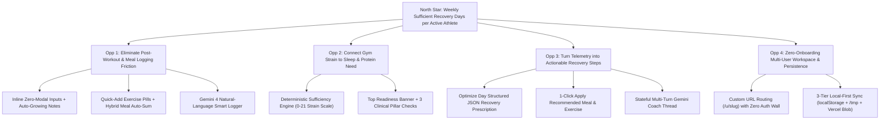

# PulseLoop MVP V1 — Product Specification & Cumulative Context Ledger

> **Author Role:** `product-manager` (Staff Product Manager AI Employee, [`.agents/skills/product-manager/SKILL.md`](../.agents/skills/product-manager/SKILL.md))  
> **Product:** **PulseLoop** — Workouts, Nutrition & Sleep Sufficiency Hub (`/Users/sabbisurendra/Downloads/Fitness`)  
> **Release Scope:** MVP V1 (Production-Shipped Vertical Slice + AI Coach Hub + Project-Scoped AI Employee Organization)  
> **North Star Metric:** **Weekly Sufficient Recovery Days per Active Athlete**  
> **Framework Stack:** Linear Method (concise, write-first specs) · Basecamp Shape Up (fixed appetite, rabbit holes, no-gos) · Teresa Torres Continuous Discovery (OST) · Jobs-to-be-Done (JTBD) · Deterministic PASS/FAIL QA Gates

---

## Executive Thesis

Most fitness apps operate as disconnected silos: workout loggers (Hevy, Strong) ignore nutrition and sleep; macro trackers (MacroFactor, Cronometer) ignore central nervous system (CNS) gym strain; and wearable ecosystems (WHOOP, Oura Ring) lock recovery readiness behind \$239–\$399/year proprietary hardware subscriptions.

**PulseLoop MVP V1** solves this by delivering a **hardware-agnostic, zero-modal, URL-native daily performance loop** (`/` and `/u/[slug]`) where workouts, macronutrient/protein fueling, and sleep architecture are evaluated together in real time—pairing instant deterministic physiology math with stateful Gemini 4 AI coaching, local-first zero-latency persistence, and a dedicated 10-role AI Employee organization governing future iterations.

---

## 1. Prompt Ledger & Cumulative Context History (All Prompts & Context Given Till Now)

Per the Product Manager directive, this section preserves **every user prompt verbatim** and the **complete cumulative technical, product, and organizational context** established up to MVP V1.

### 1.1 Verbatim User Prompts in This Conversation

| # | Timestamp | Role / Target | Verbatim User Prompt |
| :--- | :--- | :--- | :--- |
| **1** | `2026-11-17T07:42:13+05:30` | System / AI Organization Setup | *"For this project, I want to create a work setup in such a way that I will create custom AI agents/AI employees where each project will have different employees. Then they will be assigned specific roles like designer, full stack builder, AI engineer, architect, product manager, finance planner, market analyst, CEO, etc. So that the instructions can be given individually to the specific AI agents/AI employees and they will be able to work on the relevant tasks. And they should also have the expertise in the domain which they were assigned to, like design, tech, and etc. And they should be able to have good access to the related files of that particular skill and should also have some certain best practices as per the latest top 1% industry trends in their specific domains. So do all this market research and keep the title of this as Market Research AI Employees."* |
| **2** | `2026-11-17T08:21:32+05:30` | `@product-manager` | *"As Product Manager, write a MVP V1 document and add it as part of artifacts, and keep all the prompts and context given till now to write the MVP."* |

### 1.2 Cumulative Project & Codebase Evolution Context (Pre-Prompt Build Ledger)

The existing codebase in `/Users/sabbisurendra/Downloads/Fitness` establishes the following verified foundation that MVP V1 unifies and specifies:

1. **Phase 1 — Core PulseLoop Sufficiency Web Application (`commit f87fc4c`, `2026-11-17 07:15`):**
   - Built with **Next.js 15 App Router** (`^15.3.0`), **React 19** (`^19.0.0`), **TypeScript Strict Mode** (`^5.8.0`), **Tailwind CSS v4** (`^4.1.0`), and **Lucide React** icons (`^1.16.0`).
   - Implemented the closed-loop sufficiency math engine (`calculateSufficiencyAnalysis`) in `src/lib/types.ts`.
   - Built the 4 core modules inside `src/components/FitnessDashboard.tsx`: Workouts, Nutrition & Health Metrics, Sleep & Recovery Sufficiency, and Market Benchmarks.
   - Added isolated multi-user workspaces via `/` (`initialSlug="main"`) and dynamic `/u/[slug]` routes (`src/app/u/[slug]/page.tsx`), backed by 3-tier persistence (`localStorage` `0ms` + `/tmp` local filesystem + `@vercel/blob` `380ms` debounced sync via `src/app/api/state/route.ts`).
   - Added zero-FOUC adaptive Dark/Light theme parity using CSS `light-dark()` tokens and `<meta name="color-scheme">` in `src/app/globals.css` and `src/app/layout.tsx`.
2. **Phase 2 — Mandatory QA Gates & Dual Verification Skills (`commit 98d7cd4`, `2026-11-17 07:22`):**
   - Established `.agents/rules/qa-gates.md` requiring early consultation and post-edit execution of both `ux-tester` and `tech-tester`.
3. **Phase 3 — Automated Technical Invariant Verification (`commit db3c7e3`, `2026-11-17 07:36`):**
   - Added `scripts/verify-tech.mjs` enforcing security hygiene (`TECH-SEC-01`), unique-ID CRUD integrity (`TECH-LOGIC-04`), slug path-traversal prevention (`TECH-STORE-01`), and mathematical boundary invariants (`TECH-LOGIC-01..03`).
4. **Phase 4 — Gemini 4 Interactions API Hub (`src/app/api/gemini/route.ts`, `AGENTS.md`, `FitnessDashboard.tsx`):**
   - Mandated official `@google/genai` (`^3.4.0`, rule `>= 3.2.0`) and `client.interactions.create` with Gemini 4 models (`gemini-4-hydrogen`, `gemini-4-argon`, `gemini-4-carbon`) in `AGENTS.md`, strictly forbidding deprecated SDKs/models and client-side API key exposure.
   - Wired 3 live modes in `src/app/api/gemini/route.ts` and the **Gemini Interactions AI Hub** UI in `FitnessDashboard.tsx`:
     - `optimize-day`: Structured JSON `AiRecoveryPrescription` with 1-click *Log Recommended Meal* and *Add Recommended Exercise*.
     - `smart-log`: Natural-language workout, meal, cardio, and sleep delta parser with structured JSON output.
     - `coach`: Stateful multi-turn coaching thread chained via `previous_interaction_id`.
   - Added deterministic offline heuristic fallbacks (`buildFallbackPrescription`, `buildFallbackSmartLog`) so all AI workflows operate seamlessly without `GEMINI_API_KEY` or under network/quota failures.
5. **Phase 5 — Project-Scoped AI Employees Work Setup (`docs/MARKET_RESEARCH_AI_EMPLOYEES.md` & `.agents/`):**
   - Built isolated workspace skills and subagent personas for 8 specialist roles (`ceo`, `product-manager`, `market-analyst`, `finance-planner`, `architect`, `full-stack-builder`, `ai-engineer`, `designer`) plus `ux-tester` and `tech-tester`, governed by `.agents/rules/ai-employees-org.md`.

---

## 2. Strategic Discovery: Opportunity Solution Tree & Jobs-to-be-Done

### 2.1 Opportunity Solution Tree (Teresa Torres OST)

### 2.2 Core Jobs-to-be-Done (JTBD) Bifurcation

Per our PM operating model, MVP V1 serves two distinct athlete modes alongside workspace governance:

| JTBD ID | Athlete Mode / Persona | Job Statement ("When I... I want to... So I can...") | MVP V1 Solution Surface |
| :--- | :--- | :--- | :--- |
| **JTBD-01** | **Post-Workout Logging Mode** | *When I finish a gym set or eat a meal, I want to log weights, reps, macros, or natural-language summaries in under 15 seconds without modal popups, so tracking never interrupts training.* | Inline editable cards, 8 Quick-Add pills, `useMealSum` toggle, and Gemini `smart-log` with Enter-to-submit |
| **JTBD-02** | **Evening Diagnostic Mode** | *When I review my day before bed, I want to immediately see if today's total sleep, deep sleep (SWS), calories, and protein cover my gym strain, so I know what to fix tonight.* | Top Sufficiency Banner (`Readiness %`, `Gym Strain /21`, `Sleep vs Need`, `Fuel & Protein`), 3 Clinical Pillar Checks, Module 3 diagnostic cards |
| **JTBD-03** | **Prescriptive AI Coaching** | *When I detect a sleep or protein deficit, I want concrete meal/exercise prescriptions and follow-up Q&A grounded in my exact numbers, so I don't guess recovery tactics.* | `Gemini Interactions AI Hub` (`optimize-day` with 1-click meal/exercise logging + stateful `coach` thread) |
| **JTBD-04** | **Coach / Personal Portability** | *When I switch devices or manage multiple athletes/clients, I want isolated `/u/[slug]` URLs that auto-save instantly and work offline, so zero login walls block usage.* | `/u/[slug]` App Router dynamic route + `localStorage` `0ms` write + `380ms` debounced `POST /api/state` |
| **JTBD-05** | **AI Product Team Governance** | *As the project owner, I want specialized AI employees (`ceo`, `designer`, `architect`, etc.) scoped strictly to this repo with Top 1% practices, so each domain runs cleanly.* | `.agents/skills/<role>/SKILL.md`, `.agents/agents/<role>.md`, `.agents/rules/ai-employees-org.md`, `.agents/rules/qa-gates.md` |

---

## 3. Shape Up Product Specification (MVP V1)

### 3.1 Appetite & Guardrails
- **Appetite:** Complete, deployable MVP V1 vertical slice running on Next.js 15 + Vercel (or zero-config local fallback), zero external SQL/ORM setup, and zero mandatory sign-up wall.
- **Core Architectural Constraint:** Every metric recalculates deterministically on the client in `0ms` (`calculateSufficiencyAnalysis`), persists synchronously to `localStorage`, and syncs asynchronously to `/api/state` without blocking UI responsiveness.

### 3.2 Functional Module Specifications

#### Shell & Navigation (`FitnessDashboard.tsx`, `layout.tsx`, `globals.css`)
- **Editable Workspace Header:** Inline-editable `profile.displayName`, `/u/{slug}` identity badge, and `role="status" aria-live="polite"` sync badge transitioning `Syncing...` / `Saving...` -> `Auto-Saved ✓` (or `Cloud Saved ✓` when Vercel Blob is active).
- **Custom URL Switcher & Share:** Expandable `/u/<name>` switcher sanitizing `[a-z0-9-_]` and navigating to isolated athlete workspaces; 1-click `Share Link` clipboard copy with `Copied!` confirmation.
- **Adaptive Theme Toggle:** Light/Dark toggle persisted in `localStorage.getItem("color-scheme")`, dynamically updating `<meta name="color-scheme">` and CSS `light-dark()` variables with pre-paint FOUC prevention script in `src/app/layout.tsx`.
- **Date Navigation & Module Filters:** `< Previous Day`, native `<input type="date">`, `Next Day >`, conditional `Today` quick-jump, and 5 filter tabs (`All Modules`, `Workouts`, `Nutrition`, `Sleep & Recovery`, `Market Benchmarks`).

#### Closed-Loop Sufficiency Engine (`src/lib/types.ts`)
Pure function `calculateSufficiencyAnalysis(entry, profile)` computes real-time verdicts from live state:
1. **Workout Volume & Strain (`0–21` WHOOP-inspired scale):**
   - Aggregates `totalSets`, `totalReps`, and `totalVolume` (`weight * reps`) strictly from sets where `completed === true`.
   - `rawStrain`: Rest-day floor of `2.0` when `totalActiveMinutes === 0 && totalSets === 0`; otherwise `min(20.8, max(2.0, durationStrain + volumeStrain + intensityStrain))`.
2. **Strain-Adjusted Sleep Need:**
   - `strainSleepAddon`: `+0.8h` (`strainScore > 14`), `+0.5h` (`> 10`), `+0.25h` (`> 6`), or `0h` (`<= 6`).
   - `requiredSleepHours`: `(baselineSleepNeedHours || 7.5) + strainSleepAddon` (1 decimal).
   - `requiredDeepSleepHours`: `1.5h` (`strainScore >= 12`), `1.3h` (`>= 8`), or `1.1h` (`< 8`).
   - `deepSleepPercentage`: Safe `0` when `actualSleep === 0` (prevents `NaN`).
3. **Nutrition-to-Strain Sufficiency:**
   - High-strain days (`strainScore >= 12`) demand `calRatio >= 0.88` and `proteinRatio >= 0.92`; lower-strain days require `0.82` and `0.85`. Zero targets safely default ratio to `1` (no `Infinity`).
4. **Composite Readiness (`[12, 99]` integer) & Semantic Verdicts:**
   - Combines sleep duration (up to 45 pts), deep sleep repair (up to 25 pts), and protein/calories/hydration availability (up to 30 pts), clamped to `[12, 99]`.
   - Outputs `verdictLevel` (`"optimal"` Emerald + `CheckCircle2`, `"moderate"` Amber + `AlertTriangle`, `"deficit"` Rose + `AlertOctagon`), plain-English `verdictHeadline` + `verdictExplanation`, 3 `clinicalPillarChecks`, and inline `Daily Master Note`.

#### Gemini Interactions AI Hub (`src/app/api/gemini/route.ts` & `FitnessDashboard.tsx`)
- **Model Selector:** Toggle between `gemini-4-hydrogen` (default fast/cost-efficient tier) and `gemini-4-argon` (backend also supports `gemini-4-carbon`).
- **`optimize-day` Mode:** Calls `client.interactions.create` with JSON schema `response_format` to output `AiRecoveryPrescription` (`headline`, `summary`, `actionItems`, `recommendedMeal`, `recommendedExercise`). UI provides 1-click **Log Recommended Meal** and **Add Recommended Exercise** buttons that append directly into day state.
- **`smart-log` Mode:** Parses free-form descriptions (with 2 quick sample chips: *Squat + Shake*, *Cardio + Sleep*) into structured `exercisesToAdd`, `mealsToAdd`, and numeric deltas (`gymMinutesDelta`, `cardioMinutesDelta`, `sleepHoursDelta`, `deepSleepHoursDelta`). Supports `Enter` to submit (with `isComposing` / `keyCode === 229` IME guard) and `Shift+Enter` for newline.
- **`coach` Mode:** Stateful multi-turn Q&A chaining `previous_interaction_id` (excluding synthetic `offline_fallback_*` IDs) with live telemetry context (`buildTelemetryContext`) and a `New Thread` reset button.
- **Offline / Missing-Key Resilience:** If `GEMINI_API_KEY` is unset or an API error occurs, returns deterministic fallback payloads (`source: "local-fallback"`) with HTTP `200` so UX never breaks.

#### Core Tracking Modules (1–4) & AI Org (Module 5)
1. **Module 1 — Workouts & Gym Session:** Weight unit toggle (`KG` / `LBS`), session focus title, gym duration (mins), session RPE (`1–10`), cardio minutes & type, 8 quick-add exercise presets (`Barbell Squat`, `Romanian Deadlift`, `Overhead Press`, `Pull-Ups / Chin-Ups`, `Dumbbell Lateral Raise`, `Cable Tricep Pushdown`, `Barbell Curl`, `Leg Press`), unique-ID exercise & set CRUD (`Weight`, `Reps`, `RPE`, auto-computed `Volume`, `Done` checkbox dimming unchecked rows), per-exercise notes, and auto-growing `.auto-grow-textarea` session notes.
2. **Module 2 — Nutrition, Macros & Health Metrics:** Hybrid `Auto-sum totals from meal rows` (`useMealSum`) checkbox alongside 6 macro/hydration cards (`Calories`, `Protein`, `Carbs`, `Fats`, `Hydration`, `Fiber`) with progress bars clamped `0–100%`. Typing directly into any top macro card automatically sets `useMealSum: false` to preserve user overrides. Includes timed Meal Log rows with notes, customizable Health/Supplement Metrics (`Creatine Monohydrate`, `Daily Steps`, `Electrolytes / Sodium`), and auto-growing nutrition notes.
3. **Module 3 — Sleep Architecture & Sufficiency:** Editable `Base Sleep Need (hrs)`, 8-column responsive sleep grid (`Total Sleep Duration`, `Deep Sleep / SWS`, `REM Sleep`, `Sleep Quality 1–10`, `Resting HR`, `HRV`), Bedtime/Wake inputs, 2 cross-module diagnostic cards (*Is Sleep Sufficient for Today's Gym Workout?* and *Is Nutrition Sufficient for Sleep & Muscle Repair?*), and auto-growing sleep notes.
4. **Module 4 — Market Research & Clinical Benchmarks:** Built-in reference cards summarizing adopted best practices from WHOOP & Oura Ring, Apple Watch Vitals / Garmin / Samsung Energy, and Fitbit / TrueCoach / Cronometer Pro.
5. **Module 5 — Project-Scoped AI Employees Setup (`.agents/`):** 10 specialized roles (`ceo`, `product-manager`, `market-analyst`, `finance-planner`, `architect`, `full-stack-builder`, `ai-engineer`, `designer`, `ux-tester`, `tech-tester`) addressable individually in chat, via subagent delegation, or via `/teamwork` swarm.

### 3.3 Rabbit Holes Solved & Explicit V1 No-Gos

- **Rabbit Holes Addressed in V1:**
  - *Array-index deletion bugs:* Solved by strict unique ID (`ex.id`, `s.id`, `m.id`, `cm.id`) lookups (`TECH-LOGIC-04`).
  - *Write amplification to Vercel Blob on rapid typing:* Solved by synchronous `localStorage` write + `380ms` debounced `POST /api/state` coalescing (`TECH-PERF-01`).
  - *Path traversal in `/u/[slug]` storage:* Solved via `sanitizeSlug` (`[a-z0-9-_]`, max 48 chars, `"main"` fallback) (`TECH-STORE-01`).
  - *Mobile Safari auto-zoom & horizontal scroll overflow:* Solved via `@media (pointer: coarse)` `font-size: max(1rem, 1em)`, `min-block-size: 40px`, `inputMode` hints, and `.overflow-x-auto` table wrappers.
- **Explicit No-Gos (Out of Scope for MVP V1):**
  - OAuth / password login walls (deliberately replaced by frictionless `/u/[slug]` workspaces).
  - Direct Bluetooth / Apple HealthKit / WHOOP OAuth hardware sync (targeted for V2 once V1 manual + NLP smart logging proves daily retention).
  - Multi-week historical trend charts or social leaderboards (deferred to V1.1/V2 to keep daily single-screen diagnostic speed primary).

---

## 4. Deterministic PASS / FAIL Acceptance Criteria (MVP V1 Sign-Off Matrix)

Every release of MVP V1 must satisfy both `.agents/skills/ux-tester/SKILL.md` and `.agents/skills/tech-tester/SKILL.md`:

| Gate ID | Category | Verification Criterion (PASS Condition) | Owner / Verifier |
| :--- | :--- | :--- | :--- |
| **TECH-BUILD-01** | Type Safety | `npx tsc --noEmit` exits `0` under `"strict": true` with Next.js 15 async `params` typing. | `tech-tester` / `architect` |
| **TECH-BUILD-02** | Production Build | `npm run build` succeeds cleanly across `/`, `/u/[slug]`, `/api/state`, `/api/gemini` even without `BLOB_READ_WRITE_TOKEN` or `GEMINI_API_KEY`. | `tech-tester` / `full-stack-builder` |
| **TECH-LOGIC-01..03** | Sufficiency Math | `node scripts/verify-tech.mjs` confirms rest strain `2.0`, max strain `<= 20.8`, uncompleted set exclusion, safe zero-target/zero-sleep handling, and readiness `[12, 99]`. | `tech-tester` / `architect` |
| **TECH-LOGIC-04** | CRUD Integrity | All workout/set/meal/metric mutations filter/map strictly by unique `id` with zero array-index fallback. | `tech-tester` / `full-stack-builder` |
| **TECH-STORE-01..03** | Storage & Security | `sanitizeSlug` strips traversal/XSS strings and caps `<= 48` chars; 3-tier fallback (`cloud-blob -> local-fs -> default`) never returns `500`; keys scoped by `slug` and `YYYY-MM-DD`. | `tech-tester` / `architect` |
| **TECH-SEC-01** | Secret Hygiene | Zero hardcoded tokens or `GEMINI_API_KEY` exposure in client code or git-tracked files; `.gitignore` excludes `.env*.local`. | `tech-tester` / `ai-engineer` |
| **UX-RESP-01..03** | Responsive Layout | `scrollWidth <= innerWidth` at `360×800`, `768×1024`, and `1280×900` across all 5 tabs; header wraps cleanly; cards adapt `2 -> 3/4 -> 6/8` columns. | `ux-tester` / `designer` |
| **UX-THEME-01..02** | Theme & Contrast | Dark/Light toggle persists in `localStorage("color-scheme")`, syncs `<meta name="color-scheme">`, prevents FOUC, and displays text+icon+color across all 3 verdict states. | `ux-tester` / `designer` |
| **UX-FLOW-01..05** | E2E Flows & Sync | Instant banner recalculation, `KG`/`LBS` & set `Done` toggles, `useMealSum` vs. direct macro override, `.auto-grow-textarea` expansion, date isolation, and `/u/[slug]` persistence across reloads. | `ux-tester` / `full-stack-builder` |
| **UX-A11Y-01 & CONSOLE-01** | A11y & Clean Runtime | All inputs/buttons labeled (`<label>` / `aria-label`), numeric `inputMode`, `>= 16px` coarse inputs, zero console errors, zero hydration mismatches, zero `4xx`/`5xx` requests. | `ux-tester` / `designer` |

---

## 5. V1.1 / V2 Candidate Backlog (Post-MVP Roadmap Preview)

*(Requires `@ceo` + `@finance-planner` + `@architect` review before shaping)*:
1. **7-Day Rolling Recovery & Sleep Debt Sparkline:** Lightweight weekly sufficiency streak visualization without breaking the single-day workspace speed.
2. **JSON / CSV Workspace Export & Backup:** 1-click export of `/u/[slug]` history for athletes and coaches.
3. **Optional Wearable CSV / Apple Health Shortcut Import:** Zero-hardware-lock-in ingestion feeding directly into `DailyEntry` fields.
