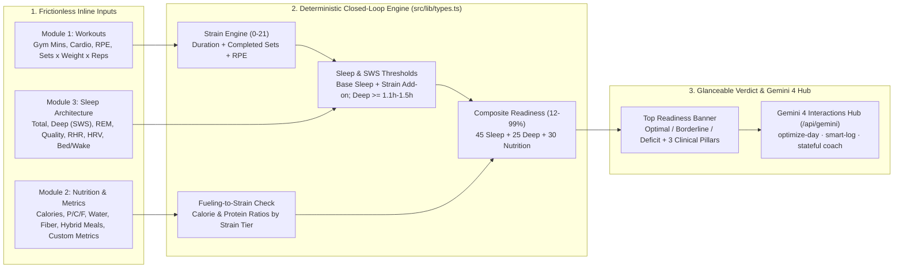
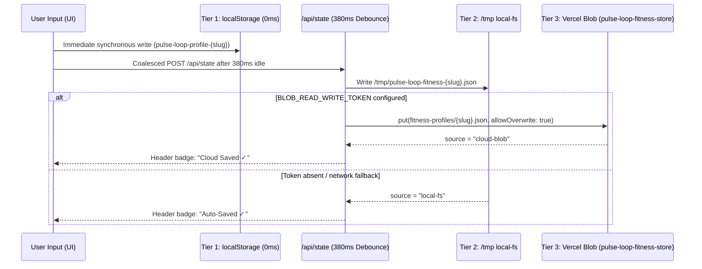

# PulseLoop Fitness — MVP v1 Master Specification & Resume-Work Guide

> **Product:** PulseLoop — Workouts, Nutrition & Sleep Sufficiency Hub (`pulse-loop-fitness`)  
> **Version:** MVP v1 (`v1.0.0`)  
> **Live Production App:** [https://pulse-loop-fitness.vercel.app](https://pulse-loop-fitness.vercel.app)  
> **Custom User Workspace Pattern:** `https://pulse-loop-fitness.vercel.app/u/<slug>` (e.g., `/u/main`, `/u/alex`)  
> **GitHub Repository:** [https://github.com/sabbisurendra-dev/pulse-loop-fitness](https://github.com/sabbisurendra-dev/pulse-loop-fitness)  
> **Cloud Storage:** Vercel Blob store `pulse-loop-fitness-store` (`fitness-profiles/<slug>.json`)  
> **Tech Stack:** Next.js `^15.3.0` (App Router) · React `^19.0.0` · TypeScript `^5.8.0` (`strict: true`) · Tailwind CSS `^4.1.0` · `@google/genai` `^3.4.0` (Gemini 4 Interactions API) · `@vercel/blob` `^1.0.0` · Lucide Icons `^1.16.0`

---

## 1. Executive Summary & Product Vision

**PulseLoop** is a URL-first, zero-login, mobile- and desktop-optimized web application that unifies **Workouts**, **Nutrition & Macros**, and **Sleep Architecture** into a single **Closed-Loop Recovery & Sufficiency Engine**.

Traditional fitness tools split an athlete's daily loop across disconnected silos—a gym logger for weights, a barcode scanner for calories, and a proprietary wearable ring or strap for sleep readiness. PulseLoop eliminates both app fragmentation and hardware lock-in by giving every user an instant, shareable URL (`/` or `/u/[slug]`) where every number, exercise, meal, sleep stage, and qualitative note can be edited inline in seconds and auto-saved across devices.

### Core Product Promises Implemented in MVP v1
1. **Closed-Loop Sufficiency Intelligence:** Gym duration, completed sets, and session RPE immediately raise tonight's **Strain-Adjusted Sleep Need**, **Deep Sleep (SWS) repair threshold**, and **Protein/Calorie fueling ratios**—producing a real-time **Readiness Score (12–99%)** and plain-English clinical verdict.
2. **Zero-Modal Inline Editing:** No multi-step popups or food-database search fatigue. Tap any metric, exercise, set, meal, custom biomarker, or note directly in place.
3. **Ubiquitous Qualitative Context:** Auto-growing inline note fields at every layer (Daily Master Note, Workout Session Note, Per-Exercise Note, Per-Meal Note, Custom Metric Note, Nutrition Note, Sleep Note).
4. **URL-Native Multi-User Workspaces:** Visiting `/` opens the default `/u/main` hub; entering or navigating to any `/u/<name>` spins up an isolated workspace backed by 3-tier persistence (`localStorage` -> `/tmp` -> Vercel Blob).
5. **Embedded Gemini 4 Performance Intelligence:** Official `@google/genai` Interactions API powering daily structured recovery prescriptions (`optimize-day`), natural-language logging (`smart-log`), and multi-turn stateful coaching (`coach`) with automatic deterministic offline fallbacks.

---

## 2. Market Research Synthesis & Clinical Positioning

PulseLoop MVP v1 was designed by synthesizing best-in-class patterns—and avoiding the primary adoption pitfalls—across 10 wearable, tracking, and clinical ecosystems (documented in `docs/IMPLEMENTATION_PLAN.md`, `docs/MARKET_RESEARCH_AI_EMPLOYEES.md`, and live in Module 4 of the app):

| Ecosystem / Platform | Core Clinical / UX Strength Adopted in PulseLoop | Adoption Pitfall PulseLoop Eliminates |
| :--- | :--- | :--- |
| **WHOOP** | **0–21 Strain Scale**, **Strain-Adjusted Sleep Need**, and closed-loop recovery narrative where gym load raises required sleep duration. | Proprietary strap subscription lock-in (`$239–$399/yr`) and missing native set/rep/weight or macro tracking. |
| **Oura Ring (Gen 4)** | **Readiness Score**, **Sleep Architecture** (Deep SWS, REM, Light, Awake), and calm editorial 1-line narrative insight leading the screen. | Passive-only tracking; cannot log resistance exercises, sets, reps, or nutrition inline. |
| **Apple Watch (Vitals)** | Glanceable multi-ring status gauges (`Readiness`, `Strain`, `Sleep vs Need`, `Fuel`), thumb-zone mobile ergonomics, and anomaly pills. | Data lives across separate sub-apps without linking macro deficits directly to sleep recovery. |
| **Garmin** | **Body Battery / Readiness** framing and acute training load vs. recovery capacity telemetry. | Cluttered multi-layer menus and high cognitive friction for daily quick entry. |
| **Samsung Galaxy Watch** | **Energy Score** summary blending sleep, activity, and physiological markers (`Optimal`, `Borderline`, `Deficit`). | Siloed from resistance tonnage and daily protein availability targets. |
| **Fitbit / Google Readiness** | Plain-English daily readiness explanations telling athletes *why* a score changed and what action to take next. | Weak granular strength logging and limited custom supplement/biomarker tracking. |
| **Hevy / Strong** | Spreadsheet-style **Set × Weight × Reps × RPE × Done ✓** inline tables, `kg`/`lbs` toggle, auto-calculated tonnage, and quick-add presets. | Ignores sleep debt and daily nutrition; does not warn when under-slept or under-fueled for heavy lifting. |
| **MacroFactor / Cronometer** | **Calories, P/C/F, Fiber, Hydration**, progress bars, and custom micronutrient/supplement rows (Creatine, Electrolytes, Steps). | Barcode/database search fatigue (~70% drop-off when athletes just want fast numbers or quick meal lines). |
| **TrueCoach + Cronometer Pro / DEXA Clinics** | Shareable coach-client workspace URLs, **Energy Availability**, protein sufficiency relative to training load, and rich free-text qualitative notes everywhere. | Requires expensive multi-portal B2B tooling instead of one instant, zero-login link. |

### Strategic Counter-Positioning
PulseLoop counter-positions against hardware-locked wearables and single-pillar loggers by unifying **training strain + fueling availability + sleep architecture** into a hardware-agnostic, zero-friction web workspace where athletes and coaches can log an entire session in under 15 seconds.

---

## 3. Complete Feature & Module Breakdown (MVP v1)



---

### 3.1 Top Closed-Loop Sufficiency & Readiness Engine (`calculateSufficiencyAnalysis`)

Implemented as a pure, side-effect-free TypeScript function in `src/lib/types.ts` (`calculateSufficiencyAnalysis(entry, profile)`), executing locally at `0ms` latency and `$0` API cost:

#### A. Workout Volume & Strain Math (`0–21` WHOOP-Inspired Scale)
- **Completed-Set Filtering:** Only sets where `s.completed === true` contribute to `totalSets`, `totalReps`, and `totalVolume` ($\sum \text{weight} \times \text{reps}$). Unchecking a set immediately excludes it from tonnage and strain.
- **Active Minutes & Intensity:**
  - `totalActiveMinutes = gymDurationMinutes + cardioMinutes`
  - `rpeFactor = clamp(sessionRpe || 6, 1, 10)`
- **Component Equations:**
  - `durationStrain = min(12, (totalActiveMinutes / 60) * 6.5)`
  - `volumeStrain = min(6, (totalSets / 18) * 4.5)`
  - `intensityStrain = ((rpeFactor - 4) / 6) * 3`
- **Clamped Bounds:**
  - Rest-day baseline (`totalActiveMinutes === 0 && totalSets === 0`): **`2.0`**
  - Active session: clamped to **`[2.0, 20.8]`**, rounded to 1 decimal (`strainScore`).

#### B. Strain-Adjusted Sleep Need & Deep Sleep (SWS) Thresholds
- **Strain Sleep Add-On:**
  - `strainScore > 14` -> **`+0.8 hrs`**
  - `10 < strainScore <= 14` -> **`+0.5 hrs`**
  - `6 < strainScore <= 10` -> **`+0.25 hrs`**
  - `strainScore <= 6` -> **`+0.0 hrs`**
- **Target & Debt:**
  - `requiredSleepHours = round1((profile.baselineSleepNeedHours || 7.5) + strainSleepAddon)`
  - `sleepDebtDelta = round1(actualSleep - requiredSleepHours)`
  - `isSleepSufficientForWorkout = actualSleep >= requiredSleepHours - 0.3`
- **Deep Sleep (Slow-Wave Sleep) Muscle Repair Threshold:**
  - `strainScore >= 12` -> **`1.5 hrs`** required
  - `8 <= strainScore < 12` -> **`1.3 hrs`** required
  - `strainScore < 8` -> **`1.1 hrs`** required
  - `deepSleepPercentage = actualSleep > 0 ? round((actualDeepSleep / actualSleep) * 100) : 0` (division-by-zero safe)
  - `isDeepSleepSufficient = actualDeepSleep >= requiredDeepSleepHours - 0.15`

#### C. Nutrition-to-Strain Sufficiency Ratios
- Guarded against zero targets (`calorieTarget > 0`, `proteinTarget > 0`, `waterTargetLiters > 0`, defaulting ratio to `1` if target is `0`):
  - **High-Strain Day (`strainScore >= 12`):** requires `calRatio >= 0.88` (88% of calorie target) **and** `proteinRatio >= 0.92` (92% of protein target).
  - **Standard / Lower-Strain Day (`strainScore < 12`):** requires `calRatio >= 0.82` **and** `proteinRatio >= 0.85`.

#### D. Composite Readiness Score (`12–99%`) & 3 Clinical Pillar Checks
- **Weighted Readiness Equation (max 100 raw points, clamped integer `[12, 99]`):**
  - `sleepDurationScore = min(45, (actualSleep / max(1, requiredSleepHours)) * 42)` *(max 45 pts)*
  - `deepSleepScore = min(25, (actualDeepSleep / max(0.5, requiredDeepSleepHours)) * 22)` *(max 25 pts)*
  - `nutritionScore = min(30, min(1.1, proteinRatio) * 15 + min(1.1, calRatio) * 10 + min(1.1, waterRatio) * 5)` *(max 30 pts)*
- **3 Clinical Pillar Checks (`clinicalPillarChecks`):**
  1. `sleepVsStrain`: `optimal` (`sleepDebtDelta >= -0.2`), `warning` (`>= -0.9`), or `deficit` (`< -0.9`).
  2. `deepSleepRepair`: `optimal` (`actualDeepSleep >= requiredDeepSleepHours`), `warning` (`>= requiredDeepSleepHours - 0.3`), or `deficit`.
  3. `nutritionVsStrain`: `optimal` (`isNutritionSufficientForWorkout`), `warning` (`calRatio >= 0.7 && proteinRatio >= 0.75`), or `deficit`.
- **Verdict Banner States (Color + Icon + Text):**
  - `optimal` -> Emerald + `CheckCircle2` + **`Optimal Recovery Loop`**
  - `moderate` -> Amber + `AlertTriangle` + **`Borderline Sufficiency`**
  - `deficit` -> Rose + `AlertOctagon` + **`Recovery / Fueling Deficit`**
- **Top Glanceable UI Strip:** 4 ring-style summary cards (`Readiness %`, `Gym Strain /21`, `Sleep vs Need`, `Fuel & Protein`), 3 clinical pillar cards, a collapsible `Open/Hide Gemini AI Hub` pill, and an inline **`Daily Master Note`** input.

---

### 3.2 Module 1: Workouts & Gym Session (`src/components/FitnessDashboard.tsx`)

- **Session Header & Unit Controls:**
  - Live header summary showing total lifted volume (`totalVolume.toLocaleString() kg/lbs`), completed sets (`totalSets`), and `totalReps`.
  - **`Unit: KG` / `Unit: LBS`** profile toggle (`profile.weightUnit`) and **`+ Add Exercise`** button.
- **4 Session Metadata Inputs (2-col mobile / 4-col desktop grid):**
  - `Workout Split / Focus` (`sessionTitle`, e.g., `"Upper Body Strength & Hypertrophy"`)
  - `Time Spent in Gym (min)` (`gymDurationMinutes`, `inputMode="numeric"`)
  - `Session Intensity (RPE 1–10)` (`sessionRpe`, `inputMode="decimal"`, clamped `<= 10`)
  - `Cardio / Conditioning (min)` + inline `Cardio Type` (`cardioMinutes`, `cardioType`)
- **8 Quick-Add Exercise Presets:**
  - One-tap pills for `+ Barbell Squat` (Legs), `+ Romanian Deadlift` (Hamstrings), `+ Overhead Press` (Shoulders), `+ Pull-Ups / Chin-Ups` (Back), `+ Dumbbell Lateral Raise` (Shoulders), `+ Cable Tricep Pushdown` (Arms), `+ Barbell Curl` (Arms), and `+ Leg Press` (Legs).
- **Hevy-Style Inline Exercise Cards & Set Table:**
  - Editable exercise name, editable muscle group badge, `+ Set` (auto-inherits previous set's weight, reps, and RPE), and delete exercise button (strict ID lookup via `ex.id === exId`).
  - Contained `.overflow-x-auto` table with columns: **`Set` | `Weight (kg/lbs)` | `Reps` | `RPE` | `Volume` | `Done ✓`** (+ per-set remove `×` button when `sets.length > 1`).
  - Unchecking `Done` dims the row (`opacity-50`) and dynamically subtracts its volume, reps, and sets from the header totals and Strain score.
  - **Per-Exercise Note** input + auto-growing **`Workout Session Notes & Gym Summary`** textarea (`.auto-grow-textarea`).

---

### 3.3 Module 2: Nutrition, Macros & Health Metrics (`src/components/FitnessDashboard.tsx`)

- **6 Primary Macro & Hydration Cards (`grid-cols-2 sm:grid-cols-3 lg:grid-cols-6`):**
  - **Calories** (`kcal`), **Protein** (`g`), **Carbs** (`g`), **Fats** (`g`), **Hydration** (`L`), and **Fiber** (`g`).
  - Both the **consumed value** and **daily target** are editable directly inline (`inputMode="decimal"`), with real-time percentage readout and progress bar clamped to `0–100%`.
- **Hybrid `useMealSum` Input Mode (Preserves User Intent):**
  - Checkbox toggle: **`Auto-sum totals from meal rows`** (`nutrition.useMealSum`).
  - When enabled (`true`), `updateCurrentDay` automatically sums `calories`, `protein`, `carbs`, and `fats` across all rows in `nutrition.meals` whenever any meal is added, edited, or deleted.
  - When disabled (`false`)—or **automatically flipped to `false` the moment a user types directly into any top macro card**—manual daily overrides are preserved without being overwritten by meal rows.
- **Timed Meal Log Breakdown (`Meals & Timed Nutrition Log`):**
  - `+ Add Meal` button; each row has `type="time"`, meal description, inline `kcal`, `P(g)`, `C(g)`, `F(g)`, remove button (`m.id === mealId`), and inline meal note.
- **Custom Health, Supplements & Biomarker Metrics:**
  - `+ Add Custom Metric` button; 3-column grid where each card has an editable metric label, value, unit, delete button (`cm.id === id`), and inline note (seeded with `Creatine Monohydrate 5 g`, `Daily Steps 10,850 steps`, `Electrolytes / Sodium 1,000 mg`).
- **Nutrition, Hydration & Gut Health Notes:** Auto-growing textarea.

---

### 3.4 Module 3: Sleep Architecture & Recovery Diagnostic (`src/components/FitnessDashboard.tsx`)

- **Configurable Baseline:** Editable **`Base Sleep Need (hrs)`** (`profile.baselineSleepNeedHours`, default `7.5`) in the section header.
- **Responsive Sleep Metrics Grid (`grid-cols-2 sm:grid-cols-4 lg:grid-cols-8`):**
  - **Total Sleep Duration (hrs)** *(2 cols at `sm+`, displays dynamic strain-adjusted `Need: Xh`)*
  - **Deep Sleep / SWS (hrs)** *(2 cols at `sm+`, displays `deepSleepPercentage%` and `min requiredDeepSleepHours`)*
  - **REM Sleep (hrs)**
  - **Sleep Quality (1–10)** *(clamped `<= 10`)*
  - **Resting HR (bpm)**
  - **HRV (ms)**
  - *(Note: `lightSleepHours` and `awakeMinutes` are also modeled in `SleepLog` and seeded in default entries for telemetry parity.)*
- **Cross-Module Sufficiency Diagnostic (`Sleep × Workout × Nutrition`):**
  - Inline `Bedtime` and `Wake` time pickers (`type="time"`).
  - Two diagnostic verdict panels answering in plain English:
    1. *"Is Sleep Sufficient for Today's Gym Workout?"*
    2. *"Is Nutrition Sufficient for Sleep & Muscle Repair?"*
- **Sleep Hygiene, Dreams & Recovery Notes:** Auto-growing textarea.

---

### 3.5 Module 4 & Gemini 4 AI Capabilities (`src/app/api/gemini/route.ts` & `FitnessDashboard.tsx`)

#### Module 4: Market Benchmarks Tab (`activeTab === "all" || activeTab === "research"`)
Displays a 3-card clinical and market reference grid summarizing how **WHOOP & Oura Ring**, **Apple Watch Vitals, Garmin & Samsung Energy**, and **Fitbit / Google Health & Clinical Coaching Portals** shaped PulseLoop's closed-loop design.

#### Gemini Interactions AI Hub (`/api/gemini`)
Built strictly in compliance with `AGENTS.md`:
- **Official SDK & Surface:** `@google/genai` (`^3.4.0`) calling **`client.interactions.create(...)`** server-side only (`GEMINI_API_KEY` is never exposed to the client).
- **Gemini 4 Model Governance:**
  - Server allowlist (`ALLOWED_MODELS`): `gemini-4-hydrogen` (default), `gemini-4-argon`, `gemini-4-carbon`.
  - UI model selector fieldset allows switching between `gemini-4-hydrogen` and `gemini-4-argon`.
  - Automatic graceful retry on `gemini-4-hydrogen` if a non-default model errors, followed by deterministic zero-cost offline fallback if the API key is missing or network/quota is unavailable.
- **Compact Telemetry Serializer (`buildTelemetryContext`):** Compresses athlete profile, sufficiency verdict, readiness/strain/volume scores, workout exercises/sets, macro targets vs. actuals, meals, sleep stages/HRV/RHR, and `dailyNote` into a high-signal prompt context.
- **3 Interactive AI Modes:**
  1. **`optimize-day` (Daily Recovery Prescription):**
     - Uses structured JSON output (`response_format: { type: "text", mime_type: "application/json", schema }`) to return `AiRecoveryPrescription` (`headline`, `summary`, `actionItems`, `recommendedMeal`, `recommendedExercise`, `model`, `interactionId`, `generatedAt`).
     - Renders 1-click **`Log Recommended Meal`** (respects `useMealSum`) and **`Add Recommended Exercise`** buttons that immediately mutate Workouts and Nutrition state and persist via auto-save.
  2. **`smart-log` (Natural-Language Smart Logger):**
     - Includes quick-fill sample chips (*"Sample: Squat + Shake"*, *"Sample: Cardio + Sleep"*) and IME-safe Enter-to-submit textarea (`e.nativeEvent.isComposing || e.keyCode === 229`).
     - Enforces a structured JSON schema returning `summaryMessage`, `exercisesToAdd[]`, `mealsToAdd[]`, and numeric deltas (`sleepHoursDelta`, `deepSleepHoursDelta`, `gymMinutesDelta`, `cardioMinutesDelta`), hydrating all three modules in one turn.
  3. **`coach` (Stateful Multi-Turn Gemini Coach):**
     - Persists `messages` and `lastInteractionId` per date in `DailyAiCoachState` (`currentDay.aiCoach`).
     - Chains conversation memory server-side via **`previous_interaction_id`** (automatically ignoring synthetic `offline_fallback_*` IDs so offline sessions never poison live threads) and includes a **`New Thread`** reset button.
- **Deterministic Offline Fallbacks:** `buildFallbackPrescription`, `buildFallbackSmartLog`, and offline coach summary ensure every AI action still returns helpful, non-500 responses when `GEMINI_API_KEY` is unset or offline.

---

## 4. Multi-User URL Routing & 3-Tier Auto-Save Architecture

### 4.1 URL Routing & Profile Isolation
- **Root Route (`src/app/page.tsx`):** Renders `<FitnessDashboard initialSlug="main" />`, giving the owner an immediate dashboard at `https://pulse-loop-fitness.vercel.app/`.
- **Dynamic User Route (`src/app/u/[slug]/page.tsx`):** Next.js 15 async route (`params: Promise<{ slug: string }>`) rendering `<FitnessDashboard initialSlug={slug} />` for any custom athlete or client URL (e.g., `/u/alex`, `/u/client1`).
- **Header Controls:** Editable workspace title (`profile.displayName`), `/u/{slug}` pill, expandable **`Custom URL`** switcher form, **`Share Link`** clipboard button, and **`< Prev` | Date Picker | `Next >` | `Today`** navigation (each date stored independently under `profile.days["YYYY-MM-DD"]`).
- **Slug Sanitization (`sanitizeSlug`):** Lowercases input, strips characters outside `[a-z0-9-_]`, truncates to `<= 48` characters, and defaults empty strings to `"main"`, preventing path traversal across filesystem and Blob keys.

### 4.2 3-Tier Persistence & Auto-Save Pipeline



- **Initial Hydration Without Waterfalls:** `FitnessDashboard` renders immediately from `localStorage` (`pulse-loop-profile-${slug}`) while running `GET /api/state?slug=<slug>` (`cache: "no-store"`). If the server returns `source === "default"` while local edits already exist, the client pushes `localData` to `/api/state` so offline edits sync upward cleanly.
- **Server Read Precedence (`readStore` in `src/app/api/state/route.ts`):**
  1. **Vercel Blob (`cloud-blob`):** When `BLOB_READ_WRITE_TOKEN` is set, looks up `fitness-profiles/${slug}.json` via `list()` and fetches with cache-busting (`?t=${Date.now()}`, `cache: "no-store"`).
  2. **Local Filesystem (`local-fs`):** Falls back to `/tmp/pulse-loop-fitness-${slug}.json`.
  3. **Deterministic Default (`default`):** Returns `createDefaultUserProfile(slug)` with rich seeded Workout, Nutrition, and Sleep data for today.

### 4.3 Adaptive Theme Parity & Mobile-First Ergonomics
- **Zero-FOUC `light-dark()` System (`src/app/globals.css` & `src/app/layout.tsx`):** Semantic CSS tokens (`--bg-canvas`, `--bg-surface`, `--bg-elevated`, `--text-primary`, `--text-muted`, `--border-subtle`) adapt automatically via native CSS `light-dark()` synced to `<meta name="color-scheme">` and persisted in `localStorage` (`"color-scheme"`), initialized by a synchronous pre-paint `<script>` in `layout.tsx`.
- **Mobile Ergonomics:** `viewportFit: "cover"`, `@media (pointer: coarse)` enforcing `font-size: max(1rem, 1em)` and `min-block-size: 40px` to prevent iOS Safari zoom on input focus, `inputMode="numeric"` / `"decimal"` keypads, and `.auto-grow-textarea` (`field-sizing: content`, `min-block-size: 2.75lh`, `max-block-size: 10lh`).

---

## 5. Project-Scoped AI Employees & Mandatory QA Governance

PulseLoop embeds an isolated, workspace-scoped **AI Employee Organization** inside `.agents/` (so it never leaks into other repositories) governed by two always-on rules and a multi-agent playbook (`docs/MARKET_RESEARCH_AI_EMPLOYEES.md`):

### 5.1 Governance Rules
- **`.agents/rules/ai-employees-org.md`:** Enforces **3-Layer Progressive Disclosure** (load only the addressed employee's `SKILL.md`), strict **File Ownership Boundaries**, and top-down SOP collaboration (`ceo`/`product-manager` -> `market-analyst`/`finance-planner` -> `architect`/`designer` -> `full-stack-builder`/`ai-engineer` -> `ux-tester`/`tech-tester`).
- **`.agents/rules/qa-gates.md` (`trigger: always_on`):** Mandates reading and applying both `ux-tester` and `tech-tester` skills early, running post-edit checks after the final code edit, and prohibiting unverified claims.
- **`AGENTS.md`:** Mandates consulting Gemini docs (`geminiDocs` MCP / `llms.txt`), using `@google/genai >= 3.2.0` (`client.interactions.create`), using only Gemini 4 models (`gemini-4-hydrogen`, `gemini-4-argon`, `gemini-4-carbon`), and never committing `.env*.local` or exposing `GEMINI_API_KEY` client-side.

### 5.2 Complete 10-Role AI Employee Directory

| Employee ID | Title | Skill & Persona Paths | Owned Files / Verification Scope |
| :--- | :--- | :--- | :--- |
| `ceo` | Chief Executive Officer | `.agents/skills/ceo/SKILL.md` · `.agents/agents/ceo.md` | `docs/MARKET_RESEARCH_AI_EMPLOYEES.md` (vision, RICE scope, North Star: Weekly Sufficient Recovery Days) |
| `product-manager` | Staff Product Manager | `.agents/skills/product-manager/SKILL.md` · `.agents/agents/product-manager.md` | `docs/MARKET_RESEARCH_AI_EMPLOYEES.md`, `.agents/skills/ux-tester/SKILL.md` (Linear/Shape Up pitches, JTBD) |
| `market-analyst` | Principal Market Analyst | `.agents/skills/market-analyst/SKILL.md` · `.agents/agents/market-analyst.md` | `FitnessDashboard.tsx` (Module 4 `research` tab), `docs/MARKET_RESEARCH_AI_EMPLOYEES.md` |
| `finance-planner` | Strategic Finance & AI FinOps Lead | `.agents/skills/finance-planner/SKILL.md` · `.agents/agents/finance-planner.md` | `docs/MARKET_RESEARCH_AI_EMPLOYEES.md` (model routing cost governance, Blob write debounce FinOps) |
| `architect` | Principal System Architect | `.agents/skills/architect/SKILL.md` · `.agents/agents/architect.md` | `src/lib/types.ts`, `src/app/api/state/route.ts`, `next.config.mjs`, `tsconfig.json` |
| `full-stack-builder` | Principal Full-Stack Builder | `.agents/skills/full-stack-builder/SKILL.md` · `.agents/agents/full-stack-builder.md` | `src/components/FitnessDashboard.tsx`, `src/app/page.tsx`, `src/app/u/[slug]/page.tsx`, `src/app/api/state/route.ts` |
| `ai-engineer` | Principal AI Engineer | `.agents/skills/ai-engineer/SKILL.md` · `.agents/agents/ai-engineer.md` | `src/app/api/gemini/route.ts`, `AGENTS.md` |
| `designer` | Staff Product Designer | `.agents/skills/designer/SKILL.md` · `.agents/agents/designer.md` | `src/app/globals.css`, `src/app/layout.tsx`, `src/components/FitnessDashboard.tsx` (layout/tokens/A11y) |
| `ux-tester` | Principal UX QA Gatekeeper | `.agents/skills/ux-tester/SKILL.md` | Mandatory evaluator: `UX-RESP-01..03`, `UX-THEME-01..02`, `UX-FLOW-01..05`, `UX-A11Y-01`, `UX-CONSOLE-01` |
| `tech-tester` | Principal Tech QA Gatekeeper | `.agents/skills/tech-tester/SKILL.md` · `scripts/verify-tech.mjs` | Mandatory evaluator: `TECH-GIT-01`, `TECH-BUILD-01..02`, `TECH-LOGIC-01..04`, `TECH-STORE-01..03`, `TECH-PERF-01`, `TECH-SEC-01` |

### 5.3 Automated Technical Invariant Script (`scripts/verify-tech.mjs`)
Verifies via Node `assert/strict`:
- **`TECH-SEC-01`:** Scans core `src/` files to guarantee zero hardcoded `vercel_blob_rw_` tokens.
- **`TECH-LOGIC-04`:** Confirms unique-ID lookup strings (`ex.id === exId`, `s.id === setId`, `m.id === mealId`, `cm.id === id`) in `FitnessDashboard.tsx`.
- **`TECH-STORE-01`:** Validates `sanitizeSlug` against traversal (`"../../../etc/passwd"` -> `"etcpasswd"`), XSS (`"<script>alert(1)</script>"`), empty/null inputs (`"main"`), and 48-char length caps.
- **`TECH-LOGIC-01..03`:** Tests rest-day baseline (`strainScore === 2.0`, uncompleted sets excluded, `0` total sleep -> `0%` deep sleep) and extreme workout clamping (`strainScore === 20.8`, `requiredSleepHours === 8.3`, `requiredDeepSleepHours === 1.5`, `readinessScore` in `[12, 99]`).

---

## 6. Live URLs, Repository Map & Verification Snapshot

### 6.1 Key Links & Infrastructure
- **Live Web App:** [https://pulse-loop-fitness.vercel.app](https://pulse-loop-fitness.vercel.app)
- **Custom Profile URL Example:** `https://pulse-loop-fitness.vercel.app/u/<your-name>`
- **GitHub Repository:** [https://github.com/sabbisurendra-dev/pulse-loop-fitness](https://github.com/sabbisurendra-dev/pulse-loop-fitness)
- **Vercel Blob Store:** `pulse-loop-fitness-store` (activated when `BLOB_READ_WRITE_TOKEN` is set in environment variables)

### 6.2 Repository Documentation & Code Map
- `README.md` — Project overview, quickstart, doc links, and resume instructions.
- `docs/MVP_V1_SPECIFICATION.md` — Repository copy of this MVP v1 Master Specification.
- `docs/IMPLEMENTATION_PLAN.md` — Original market research synthesis, 5 architectural decisions, and MVP roadmap.
- `docs/MARKET_RESEARCH_AI_EMPLOYEES.md` — Detailed AI employee organization architecture, file-ownership matrix, and usage prompts.
- `AGENTS.md` — Mandatory Gemini 4 SDK & security rules.
- `src/lib/types.ts` — Core domain interfaces, default profile factory, and `calculateSufficiencyAnalysis`.
- `src/components/FitnessDashboard.tsx` — Unified client dashboard (Top Sufficiency Banner, Gemini 4 AI Hub, Modules 1–4).
- `src/app/api/state/route.ts` — 3-tier persistence API (`GET`/`POST /api/state`).
- `src/app/api/gemini/route.ts` — Gemini 4 Interactions API handler (`optimize-day`, `smart-log`, `coach`).
- `scripts/verify-tech.mjs` — Automated technical invariant check suite.

### 6.3 MVP v1 Verification Snapshot
During compilation of this MVP v1 specification, the following static & invariant checks were directly executed and observed passing (`exit 0`):
- `npx tsc --noEmit` — Passed with zero TypeScript errors under `"strict": true`.
- `node scripts/verify-tech.mjs` — Printed `ALL TECH-TESTER INVARIANTS PASSED!`.
*(Note: Full Next.js production build `npm run build` and GitHub remote push verification are executed by the `github-sync` / `verifier` pipeline as part of release finalization.)*

---

## 7. Step-by-Step Guide to Resume Work Anytime

### Step 1: Clone or Open the Workspace
```bash
git clone https://github.com/sabbisurendra-dev/pulse-loop-fitness.git
cd pulse-loop-fitness
npm install
```
*(Or open `/Users/sabbisurendra/Downloads/Fitness` directly in Antigravity IDE.)*

### Step 2: Configure Environment Secrets (Local Development)
Create `.env.local` in the project root (already ignored by `.gitignore` via `.env*.local`):
```bash
GEMINI_API_KEY="your-gemini-api-key"
# Optional for local cloud-blob testing; when omitted, /api/state uses /tmp local-fs cleanly
BLOB_READ_WRITE_TOKEN="your-vercel-blob-read-write-token"
```
Start the local dev server:
```bash
npm run dev
```
Open `http://localhost:3000` (defaults to `/u/main`) or `http://localhost:3000/u/alex`.

### Step 3: Run Pre-Edit & Post-Edit QA Verification
Before and after making any code or UI changes, run the mandatory technical gates defined in `.agents/rules/qa-gates.md`:
```bash
npx tsc --noEmit
node scripts/verify-tech.mjs
npm run build
```
And verify responsive layout (`360px` / `768px` / `1280px`), Dark/Light theme parity, inline CRUD, `useMealSum` behavior, and auto-save persistence per `.agents/skills/ux-tester/SKILL.md`.

### Step 4: Resume Building Using PulseLoop AI Employees
You can resume product, architecture, design, or AI work at any time by addressing individual project-scoped AI employees in chat or launching a `/teamwork` swarm:
- **Strategy & Priorities:** *"As `ceo`, review MVP v1 and prioritize the top 2 enhancements for v1.1."*
- **Product Spec:** *"As `product-manager`, write a Shape Up pitch for a 7-day readiness trend strip without slowing daily logging."*
- **Data / Storage / Security:** *"As `architect`, extend `src/lib/types.ts` with weekly streak metrics while keeping backward compatibility with existing Blob JSON profiles."*
- **UI & Mobile Polish:** *"As `designer`, audit light-mode contrast and 360px wrapping in `FitnessDashboard.tsx` and `globals.css`."*
- **Feature Engineering:** *"As `full-stack-builder`, add JSON/CSV workout export using unique-ID safety."*
- **Gemini 4 AI:** *"As `ai-engineer`, enhance `smart-log` in `src/app/api/gemini/route.ts` to parse custom metrics like hydration and creatine."*
- **Competitive & FinOps Review:** Address `@market-analyst` or `@finance-planner`.

### Step 5: Ship Updates to GitHub & Vercel
1. Ensure `.env*.local`, `.vercel/`, `node_modules/`, and `.next/` remain untracked (`git status`).
2. Commit and push to `main`:
   ```bash
   git add -A
   git commit -m "Your descriptive change"
   git push origin main
   ```
3. Deploy or verify live production at [https://pulse-loop-fitness.vercel.app](https://pulse-loop-fitness.vercel.app) (with `GEMINI_API_KEY` and `BLOB_READ_WRITE_TOKEN` configured in Vercel Project Settings for `pulse-loop-fitness-store`).
