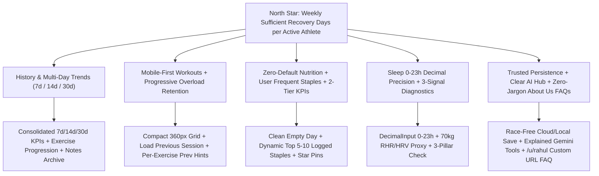

# PulseLoop PRD V2 — Product Requirements, Algorithmic Logic & Architecture

> **Author Role:** `product-manager` (Staff Product Manager AI Employee)  
> **Consulting Team:** `ceo`, `designer`, `architect`, `full-stack-builder`, `ai-engineer`, `market-analyst`, `ux-tester`, `tech-tester`  
> **Product:** **PulseLoop** — Closed-Loop Workouts, Nutrition, Sleep & Recovery Web App  
> **North Star Metric:** **Weekly Sufficient Recovery Days per Active Athlete**  
> **Framework Stack:** Linear Method · Basecamp Shape Up · Teresa Torres OST · Deterministic PASS/FAIL QA Gates

---

## 1. Prompt & Product Evolution Context Ledger

| Version / Prompt | Date | Scope & Product Owner Direction |
| :--- | :--- | :--- |
| **Prompt 1** | `2026-11-17` | Created PulseLoop's specialized AI Employees organization (`ceo`, `product-manager`, `designer`, `architect`, `full-stack-builder`, `ai-engineer`, `market-analyst`, `finance-planner`) and `Market_Research_AI_Employees.md`. |
| **Prompt 2** | `2026-11-17` | Produced MVP V1 specification (`MVP_V1.md`) preserving cumulative project and prompt context. |
| **Prompt 3 (MVP V1)** | `2026-11-17` | Categorized **1. Workouts** (removed RPE & volume clutter; clean Exercise × Weight × Reps + Set/Delete), **2. Nutrition** (Global USDA + Indian ICMR-NIN open food search, portion size with gram weights, auto-summed Calories/Protein/Carbs/Fats/Hydration/Fiber), **3. Sleep & Recovery** (direct sleep hours + 1–10 quality rating + 70 kg Indian adult male RHR/HRV approximation), and **About Us** (Pitch, Core USP, Value Add + aligned Industry Market Research). |
| **Prompts 4–5** | `2026-11-17` | Pushed codebase to `sabbisurendra-dev/Fitness` (`main`) and deployed to Vercel (`https://pulse-loop-fitness.vercel.app`). |
| **Prompt 6 (V2 Scope)** | `2026-11-17` | Requested V2 upgrades: multi-day **History & Trends** (weekly / 2-week / monthly consolidated summaries + day-by-day drill-down), **iPhone mobile-first Workouts ergonomics** (eliminate wide gaps between Set/Weight/Reps/Done) + **previous session weight/rep retention**, top card cleanup (remove internal wearable/engine jargon & `Hide Gemini AI Hub` tag; make **Total Calories** primary & Protein secondary in `Fuel & Protein`), fix **comment saving reliability**, clarify **Gemini Interactions AI Hub** background workflows (`Optimize Day`, `Smart Logger`, `Stateful Coach`), **zero pre-filled default Nutrition items**, replace static staples emphasis with **Your Frequently Eaten Staples** dynamically ranked from user logs, **2-tier Nutrition metric hierarchy** (Calories #1, Protein #2, remaining 4 smaller), clean Supplement placeholders, fix Sleep **decimal entry & 0–23h range**, upgrade recovery diagnostics, stop repeating top banner above **About Us**, add **Simple FAQs with real Custom URL examples**, and label the header theme button (`Light Mode` / `Dark Mode`). |

---

## 2. Opportunity Solution Tree & V2 Goals

---

## 3. Scoring & Algorithmic Logic (Transparent Reference)

All sufficiency calculations execute deterministically in [`src/lib/types.ts`](../src/lib/types.ts) via `calculateSufficiencyAnalysis(entry, profile)`:

### 3.1 Gym Strain Mechanism (`2.0` to `20.8` on `/21` Scale)
- **Active Minutes (`totalActiveMinutes`):** `gymDurationMinutes + cardioMinutes`
- **Completed Working Sets (`totalSets`):** Count of exercise sets where `completed === true` (unchecked sets are excluded).
- **3 Strain Components:**
  1. **Duration Strain (`0–12`):** `min(12, (totalActiveMinutes / 60) * 6.5)`
  2. **Volume Strain (`0–6`):** `min(6, (totalSets / 18) * 4.5)`
  3. **Intensity Strain (`-1.5` to `3`):** `((rpeFactor - 4) / 6) * 3` (defaults to moderate baseline `6` -> `+1.0`)
- **Final Score:**
  - If `totalActiveMinutes === 0 && totalSets === 0`: rest day floor `2.0 / 21`.
  - Otherwise: `clamp(durationStrain + volumeStrain + intensityStrain, 2.0, 20.8)`.

### 3.2 Readiness Score Mechanism (`12%` to `99%`)
Readiness blends **Sleep Duration (`45 pts`)**, **Deep Sleep SWS Repair (`25 pts`)**, and **Fueling & Hydration (`30 pts`)** scaled against today's Strain:

1. **Strain-Adjusted Sleep Need (`requiredSleepHours`):**
   - `baselineSleepNeedHours` (default `7.5h`) + strain addon (`+0.8h` if Strain `> 14`, `+0.5h` if `> 10`, `+0.25h` if `> 6`, else `+0h`).
   - **Sleep Duration Points (max `45`):** `min(45, (actualSleep / max(1, requiredSleepHours)) * 42)`
2. **Deep Sleep Threshold (`requiredDeepSleepHours`):**
   - `1.5h` if Strain `>= 12`, `1.3h` if Strain `>= 8`, else `1.1h`.
   - **Deep Sleep Points (max `25`):** `min(25, (actualDeepSleep / max(0.5, requiredDeepSleepHours)) * 22)`
3. **Nutrition Fueling Points (max `30`):**
   - **Protein (`15 pts`):** `min(1.1, protein / proteinTarget) * 15`
   - **Calories (`10 pts`):** `min(1.1, calories / calorieTarget) * 10`
   - **Hydration (`5 pts`):** `min(1.1, waterLiters / waterTargetLiters) * 5`
   - Combined `nutritionScore = min(30, proteinPts + calPts + waterPts)`
4. **Final Composite Readiness:** `clamp(round(sleepDurationScore + deepSleepScore + nutritionScore), 12, 99)`

### 3.3 70 kg Indian Adult Male Autonomic Approximation (`0–23` hrs)
Computed in `approximateSleepBiometricsForIndianMale70kg(totalHours, sleepQuality)`:
- Supports **`0` to `23` hours** with decimal granularity (`1.2h`, `1.5h`, `7.5h`).
- When `hours === 0`, returns `0` across stages, awake minutes, Resting HR, and HRV so unlogged days show clean zeros rather than synthetic biometrics.
- When `hours > 0`:
  - `deepRatio = 0.15 + (quality / 10) * 0.065`
  - `remRatio = 0.18 + (quality / 10) * 0.05`
  - `sleepDelta = clamp(hours - 6.5, -2.5, 2.0)`
  - `restingHeartRate = clamp(round(68 - (quality - 5) * 1.4 - sleepDelta * 1.8), 48, 84)` (e.g., `7.5h`, quality `8/10` -> **62 bpm**)
  - `hrvMs = clamp(round(42 + (quality - 4) * 3.5 + sleepDelta * 4), 25, 95)` (e.g., `7.5h`, quality `8/10` -> **60 ms**)

---

## 4. Detailed V2 Feature Specifications

### Feature A: `History & Trends` Tab (Consolidated 7d / 14d / 30d + Day-by-Day Overview)
Backed by [`src/lib/historyAndStaples.ts`](../src/lib/historyAndStaples.ts) (`computePeriodSummary`):
- **Timeframe Selector:** Instant toggle across **7 Days (Week)**, **14 Days (2 Weeks)**, and **30 Days (Month)** ending on `selectedDate`.
- **4 Consolidated Period KPIs:**
  - **Workouts:** Session count, total completed sets, total reps, gym minutes, cardio minutes.
  - **Nutrition Avg / Day:** Daily average Calories, Protein, Carbs, Fats, and count of days hitting `>=90%` protein goal.
  - **Sleep Avg / Night:** Average duration, average 1–10 sleep quality, average Resting HR, and average HRV.
  - **Recovery Consistency:** Average Readiness `%` plus breakdown of Optimal / Moderate / Deficit days.
- **Exercise Progression Tracker:** Compares earliest vs. latest working top weight for each exercise performed in the selected window (`+weightDelta`).
- **Day-by-Day In-Depth Breakdown & Saved Notes Archive:** Lists every logged date with Readiness, Strain, Workouts/Nutrition/Sleep snapshot, all saved notes (`Daily Summary`, `Workouts`, `Nutrition`, `Sleep`), and a 1-tap **`Open Day`** button to jump straight to that date.

### Feature B: iPhone Mobile-First Workouts & Previous Session Retention
- **Zero-Gap Compact Set Grid (`360px–430px` Mobile Ergonomic):**
  - Tight CSS grid `grid-cols-[2.25rem_5.5rem_4.5rem_1fr]` (`Set | Weight | Reps | Done`) keeps Weight, Reps, and Done side-by-side without horizontal sprawl.
  - Uses `<DecimalInput>` for weight (`allowDecimal`) and reps (`allowDecimal={false}`).
- **Previous Session Retention (Progressive Overload):**
  - `findPreviousWorkoutSession(profile, selectedDate, sessionTitle)` powers **`Load Prev (MM-DD)`** to pre-populate the previous session's exercises, weights, and reps with fresh unique IDs.
  - `findPreviousExerciseSets(profile, selectedDate, name)` renders inline **`Previous (YYYY-MM-DD): 60kg×8 · 65kg×6`** hints inside every matching exercise card and carries those values forward when Quick-Adding exercises.

### Feature C: Clean Top Summary Card & Reliable Comment Persistence
- **Scoped Visibility:** Top Summary Banner renders on `All Modules`, `1. Workouts`, `2. Nutrition`, and `3. Sleep & Recovery`, hiding cleanly on `History & Trends` and `About Us`.
- **Fuel & Protein Hierarchy:** Displays **Total Calories (`kcal`)** as the prominent figure with **Protein (`Xg / Yg`)** clearly shown beneath.
- **Comment Save Fix:**
  - Guarded `loadProfile()` with `hasUserEditedRef` and `updatedAt` timestamp comparison (`localTs > serverTs`) so mount fetches never clobber typed notes.
  - Added immediate `flushSaveNow()` on blur across note inputs plus `pagehide` (`keepalive: true`) flush and an explicit **`Save Note`** button + timestamp status inside `Daily Summary Comment / Check-In`.

### Feature D: Gemini Interactions AI Hub Clarity
- Added **How the 3 Gemini Tools Work** summary banner directly inside the Hub (`Optimize Day with Gemini`, `Natural-Language Smart Logger`, `Stateful Gemini Coach`) + header collapse/expand toggle:
  1. **Optimize Day with Gemini (`mode: "optimize-day"`):** Analyzes today's Workouts + Nutrition + Sleep telemetry via `POST /api/gemini` and returns 3 actionable steps plus 1-click prescribed meal & low-CNS recovery finisher.
  2. **Natural-Language Smart Logger (`mode: "smart-log"`):** Parses casual plain-English logs (including Indian meals) into structured workout sets, meals, cardio, or sleep deltas.
  3. **Stateful Gemini Coach (`mode: "coach"`):** Maintains multi-turn coaching threads via `previous_interaction_id` (`@google/genai` `client.interactions.create`), with deterministic `local-fallback` resilience offline.

### Feature E: Zero-Default Nutrition, 2-Tier Visual Hierarchy & User Frequent Staples
- Fresh days initialize completely empty (`meals: []`, `exercises: []`, `calories: 0`, `protein: 0`, `sleep.totalHours: 0`, empty supplement values/notes).
- **2-Tier Visual Hierarchy:** Primary Calories + Protein cards on top; compact Carbs, Fats, Hydration, Fiber cards underneath.
- **Your Frequently Eaten Staples:** Computed via `computeUserFrequentStaples(profile, 10)` from the user's own logged meals across days + pinned items (`Pin` toggle on search results -> `profile.pinnedStaples`), each with quantity control and 1-tap **`+ Add`**.

### Feature F: Sleep `0–23h` Decimal Entry & 3-Signal Diagnostics
- `<DecimalInput>` preserves raw typing (`"1."`, `"1.2"`, `"1.3"`, `"7.5"`, `"23"`) cleanly mid-keystroke.
- Upgraded **Cross-Module Sufficiency Diagnostic** to 3 concise actionable insights: **1. Sleep vs. Training Load**, **2. Protein & Energy Synthesis Check**, and **3. Autonomic Read (70 kg RHR & HRV Proxy)**.

### Feature G: Header Theme Toggle & `About Us` FAQs
- Header theme button displays explicit **`Light Mode`** / **`Dark Mode`** label with cross-tab `storage` sync.
- `About Us` removes backend wearable brand jargon from top cards and adds **Quick Guide & FAQs** with real Custom URL examples (`/u/rahul`, `/u/client-ananya`).

---

## 5. Verification Gates

All edits must pass:
1. `npx tsc --noEmit` — zero TypeScript errors.
2. `node scripts/verify-tech.mjs` — all security (`TECH-SEC-01`), sufficiency logic (`TECH-LOGIC-01..04`), storage (`TECH-STORE-01`), `0–23h` Indian 70 kg baseline, and V2 UI invariants pass.
3. `npm run build` — clean Next.js App Router production build.
